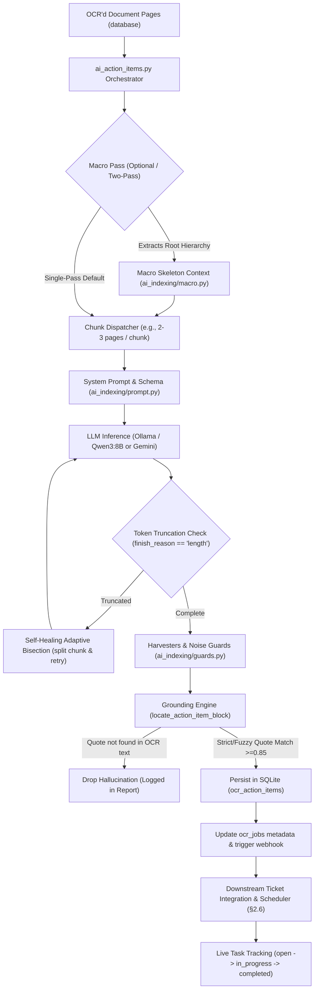
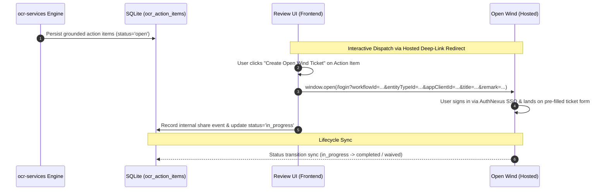
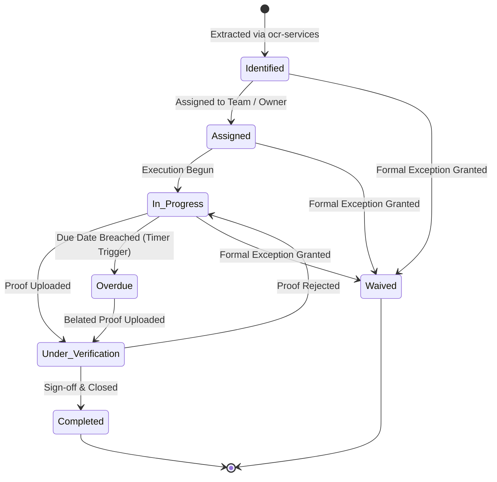

# Action Items Extraction System — Architecture, Pipeline, and Gold Benchmark Overview

This document provides a comprehensive technical guide and reference for the **Action Items Extraction** system within `ocr-services`. It details what action items are, how the end-to-end extraction and grounding pipeline works, the architectural safeguards that enforce accuracy and eliminate hallucinations, the downstream action-management lifecycle, and concrete examples extracted across legal judgments and public procurement benchmarks.

---

## 1. What Are Action Items?

In legal, commercial, and government procurement documents, raw textual OCR and hierarchical document structure (chapters, sections, sub-clauses) are only the foundation. Users need immediate operational visibility into actionable covenants, critical deadlines, qualification criteria, and binding outcomes.

The **Action Items Extraction** pipeline identifies, classifies, extracts, and grounds these operative items into a structured taxonomy:

| Item Type | Definition | Operational Distinction | Typical Examples |
| :--- | :--- | :--- | :--- |
| **`deadline`** | An action that must be taken on or before a calendar date or within an elapsed timeframe relative to an anchor event. | Hard calendar or milestone cutoff requiring chronological alerting. | Bid submission cutoff, pre-bid meeting date/time, LOA acceptance window ("within 30 days of LOA"), Bank Guarantee expiry. |
| **`obligation`** | A mandatory affirmative duty, compliance requirement, or qualification standard imposed on a responsible party. | **One-time** eligibility threshold vs. **Recurring** periodic operational duty (tracked via `cadence`). | Financial turnover thresholds (₹100 Cr average turnover), positive net worth covenants, weekly progress reports, monthly SLA submissions. |
| **`condition`** | A contingency, prerequisite, penalty, or rule governing what happens if an event occurs. | Rule-based trigger activated only upon conditional breach or event. | Liquidated damages (0.5% per week up to 10%), stage penalties for milestone shortfalls, key date rollover on public holidays. |
| **`other`** | Operative procedural actions specific to adjudicatory/judicial documents that do not fit standard commercial contracts. | Binding judicial orders, prayers, and administrative registry directives. | Applications for stay of arbitral awards, prayer for interim relief, trial court disposition orders ("petition dismissed with costs"), court registry directions. |

---

## 2. End-to-End System Architecture

The action items pipeline operates as a decoupled extraction and action-management pipeline. While document structure indexing builds a tree of parent-child sections (`reference_index.py`), action items form a grounded set of obligations persisted in SQLite (`ocr_action_items`) and dispatched downstream to task trackers and notification dispatchers.



### 2.1 Chunking & Context Management
1. **Sliding Page Chunks**:
   - Documents are processed in small page windows (typically 2–3 pages) configured via `AI_INDEX_CHUNK_PAGES`.
   - Action items do not rely on hierarchical parent carries across chunk boundaries. If an item appears on an overlap page, the latest chunk's version supersedes it cleanly in the database ("last chunk wins").
2. **Cross-Page Quote Boundary Handling**:
   - In legal contracts, clauses can span across page breaks. Prompt instructions require candidate `evidence_quote` snippets to be $\le 1$ page, anchoring to the primary page where the operative duty is mandated.
   - If an item's quote is split across chunk boundaries, the grounding engine logs any boundary failure and attempts fallback grounding against concatenated page boundaries.
3. **Self-Healing Adaptive Chunking**:
   - Dense pages (e.g. Bill of Quantities, technical specification tables, detailed eligibility grids) can overflow the model's output token limit (`num_predict`).
   - If an LLM response indicates truncation (`finish_reason == "length"`), the chunk dispatcher bisects the chunk into smaller sub-chunks (e.g., `[1, 2, 3, 4]` $\rightarrow$ `[1, 2]` and `[3, 4]`) and re-processes them independently. This prevents truncated responses from silently dropping trailing obligations.
4. **Macro Context Skeleton**:
   - In large tenders, background descriptions (such as 40 pages listing software modules already deployed) use obligatory wording ("the contractor shall maintain...") that describes legacy operations rather than new bidding requirements.
   - The two-pass macro skeleton injects high-level document headers into chunk prompts, providing the model with boundary awareness so it extracts only active requirements.

### 2.2 Prompt Engineering & Structured Contract

The model is constrained by an explicit JSON schema (`AIActionItemChunk`):
- `item_type`: Restricted to `"deadline" | "obligation" | "condition" | "other"`.
- `item_text`: A concise, active-voice summary of the action required.
- `date_text`: The raw date or timeframe string (e.g. `"29.09.2026 up to 15:00 Hrs."` or `"within 18 months"`).
- `date_iso`: Normalized ISO-8601 date (`YYYY-MM-DD`) when an absolute calendar date is present.
- `anchor_event`: The triggering event when a date is relative (e.g. `"signing of contract"`, `"issue of LOA"`).
- `evidence_quote`: **Verbatim text snippet** ($\le 1$ page) from the OCR content demonstrating where the item originated.
- `responsible_party`: Entity bound by the item (e.g. `"Bidder"`, `"Contractor"`, `"Appellant"`, `"Employer"`).
- `confidence`: `"high" | "medium" | "low"`.
- `cadence`: Standardized recurrence pattern (`"weekly"`, `"monthly"`, `"quarterly"`, `"annual"`, `"per-milestone"`, or RFC 5545 `RRULE` format) for periodic obligations.
- `recurrence_anchor`: The bounding duration event (e.g. `"throughout contract duration"`, `"during 5-year O&M period"`).
- `procedure_ref`: Structured cross-reference to referenced formats, annexures, or clauses: `{ "type": "annexure" | "schedule" | "form" | "clause", "ref_key": string }` (e.g. `{ "type": "clause", "ref_key": "clause:11-SCC" }` or `{ "type": "annexure", "ref_key": "annexure:b" }`), directly resolvable via `reference_index.py`.

#### Field Requirement Matrix

To enable strict server-side schema validation prior to persistence, fields must adhere to the following requirement matrix:

| Field | `deadline` | `obligation` | `condition` | `other` | Validation Rule |
| :--- | :--- | :--- | :--- | :--- | :--- |
| `item_type` | **Required** | **Required** | **Required** | **Required** | Must match allowed enum. |
| `item_text` | **Required** | **Required** | **Required** | **Required** | Non-empty string $\le 300$ chars. |
| `evidence_quote` | **Required** | **Required** | **Required** | **Required** | Verbatim snippet $\le 1$ page. |
| `responsible_party` | **Required** | **Required** | **Required** | **Required** | Identified party or `"All Parties"`. |
| `confidence` | **Required** | **Required** | **Required** | **Required** | Enum: `"high" \| "medium" \| "low"`. |
| `date_text` | **Required** | Optional | Optional | Optional | Verbatim temporal phrase. |
| `date_iso` | **Conditional\*** | — | — | — | Required when date is absolute calendar date. |
| `anchor_event` | **Conditional\*** | Optional | Optional | — | Required when date is relative elapsed timeframe. |
| `cadence` | — | Optional | — | — | Populated when duty is repeating/periodic. |
| `recurrence_anchor` | — | Optional | — | — | Bounding contract window for cadence. |
| `procedure_ref` | Optional | Optional | Optional | — | Structured link to Annexure/Form/Clause. |

*\*Note on Deadlines: At least one of `date_iso` (for absolute deadlines) OR `anchor_event` (for relative deadlines) must be present for every valid `deadline` item.*

#### Table Artifacts & Date Normalization Contract
OCR table extraction can introduce HTML cell artifacts (e.g. `</td><td>`) and merged whitespace tokens (e.g. `30.10.202615:30 Hrs.`) inside `evidence_quote`. 
* **Grounding Engine Contract**: `evidence_quote` retains the exact raw OCR text (including artifacts) to ensure 100% string alignment against the OCR text block.
* **Date Normalization Contract**: Normalization parsers derive `date_iso` strictly from LLM-cleaned `date_text` (e.g. `"30.10.2026 15:30 Hrs."`), guaranteeing clean ISO date parsing without noise interference.

### 2.3 Noise Guards and Harvesters
To prevent flooding the output with boilerplate legalese:
- **Noise Guards (`ai_indexing/guards.py`)**:
  - Filter out historical recitals, statutory preambles ("Whereas the Government of India enacted..."), standard court appearances, and non-actionable definitions.
  - Suppress repetitive page headers, footers, and generic tender disclaimers.
- **Rule Harvesters (`ai_indexing/harvesters.py`)**:
  - Provide deterministic regex matching for high-stakes dates (NIT bid submission windows, pre-bid meeting stamps) and financial figures to augment LLM recall.
  - **Universal Grounding Rule**: Every item produced by deterministic harvesters passes through the **identical 0.85 grounding engine** before persistence, preventing false positives from OCR header artifacts or spurious table numbers.

### 2.4 Grounding Verification (Anti-Hallucination Stack)
Every candidate action item returned by the LLM or harvester must pass strict grounding in `locate_action_item_block`:
1. The candidate's `evidence_quote` is normalized: HTML entities are decoded (`&amp;` $\rightarrow$ `&`), whitespace is unified, and typographic quotes are flattened.
2. The engine scans the OCR word blocks for that page:
   - **Exact Substring Match**: Finds the exact sequence of words.
   - **Fuzzy difflib Match ($\ge 0.85$ similarity)**: Accommodates minor OCR character artifacts (e.g., hyphenation or broken ligatures).
3. **Rejection Rule**: If an evidence quote cannot be grounded against the actual page text, it is **dropped immediately** as an ungrounded hallucination. This mechanism maintains a **$99.7\% - 100\%$ Grounding Rate** across all benchmark runs.

### 2.5 Storage, Lifecycle, and Persistence
Results are persisted in the `ocr_action_items` table in SQLite:
- **Identity & Indexing**: Indexed by `job_id`, `page`, `item_type`, and `occurrence_index`.
- **Temporal & Attribution Fields**: Normalized `date_iso`, `anchor_event`, `cadence`, `recurrence_anchor`, `responsible_party`, and block bounding box coordinates.
- **Cross-Reference Links**: `procedure_ref` stored as structured JSON string.
- **Action Lifecycle Fields**:
  - `status`: `TEXT DEFAULT 'open'` (`'open' | 'in_progress' | 'completed' | 'waived'`).
  - `ticket_id`: `TEXT NULL` — foreign key populated by external ticket tracking systems (Jira, Linear, GitHub Issues, internal ERP).
- **Idempotency Constraint**: A composite unique index on `(job_id, page, evidence_quote)` ensures that adaptive bisection retries or job re-runs are idempotent, preventing duplicate rows or ticket generation.
- **Job-Level Telemetry**: `ocr_jobs.action_item_report` persists summary telemetry (`items_found`, `items_dropped_ungrounded`, `duration_seconds`).

---

### 2.6 Downstream Action Tracking & Open Wind Integration

To transform raw extracted items into workable, tracked obligations, the system integrates with **Open Wind** (hosted at `https://work.rokkalabs.com`, as implemented in `tender_ai`). This decouples OCR extraction from task execution while providing an immediate operational bridge to compliance teams.



#### 1. Hosted Deep-Link Redirect Integration Contract
Rather than requiring high-privilege administrative API keys for ticket creation, Open Wind uses a secure **client-side hosted redirect model** authenticated through **AuthNexus SSO** (`https://auth.rokkalabs.com`).

* **Deep-Link Endpoint**:
  ```
  ${VITE_OPENWIND_APP_URL}/login?workflowId=${WORKFLOW_ID}&entityTypeId=${ENTITY_TYPE_ID}&appClientId=${APP_CLIENT_ID}&title=${ENCODED_TITLE}&remark=${ENCODED_REMARK}
  ```
* **Required Parameters**:
  - `workflowId`: Target Open Wind workflow UUID (e.g., `a3b4d676-eae9-4dda-8616-bfc2890e38f6`).
  - `entityTypeId`: Target Open Wind entity type UUID (e.g., `3fc37d09-e113-4f2a-815e-4126c80de062`).
  - `appClientId`: AuthNexus Client ID (`VITE_CLIENT_ID`). **Mandatory**: Tells the `/login` handler which SSO client initiated the redirect so it preserves the deep-link destination after login rather than falling back to the generic dashboard.
  - `title`: Short, active-voice summary of the obligation (`item_text`).
  - `remark`: Structured Markdown payload containing complete context, page attribution, and audit quotes.

#### 2. Action Item to Open Wind Parameter Mapping

| Action Item Field | Open Wind Parameter | Transformation / Content |
| :--- | :--- | :--- |
| `item_text` | **`title`** | Concise action description (e.g., *"Submit Techno-Commercial Bid (Cover-2)"* or *"Testing & Commissioning of Sub-Stations"*). |
| All Metadata | **`remark`** | Structured plain-text/markdown block pre-populating ticket body:<br>```text<br>Item Type: deadline<br>Due Date: 2026-09-29 (29.09.2026 up to 15:00 Hrs.)<br>Responsible Party: Bidder<br>Document: tender-135p (Page 5)<br>Procedure Ref: format:cover-1-cover-2<br>Quote: "Due date of submission of Tender..."<br>``` |
| `workflowId` | URL Query Param | Workflow UUID for Tender / Contract Action Items |
| `entityTypeId` | URL Query Param | Entity Type UUID for Action Items / Compliance Tickets |
| `appClientId` | URL Query Param | AuthNexus SSO Client ID for seamless deep-link authentication |

#### 3. Proposed Open Wind Workflow Schema (For Review)

To standardize action tracking within Open Wind, the following **Contract & Tender Action Item Workflow Schema** is proposed for review:

##### A. Entity Definition (`entityTypeId: ContractActionItem`)
* **Core Attributes**:
  * `title` (String, Required, max 255): Summary of action.
  * `item_type` (Enum: `deadline`, `obligation`, `condition`, `other`).
  * `responsible_party` (String: `Bidder`, `Contractor`, `Client/Employer`, `Court/Registry`, `All Parties`).
  * `due_date` (Date, Nullable): Absolute ISO calendar deadline (`date_iso`).
  * `anchor_event` (String, Nullable): Trigger milestone for relative deadlines.
  * `cadence` (Enum: `none`, `weekly`, `monthly`, `quarterly`, `annual`, `per-milestone`).
  * `recurrence_anchor` (String, Nullable): Bounding window (e.g., *"throughout 5-year O&M period"*).
  * `procedure_ref` (String, Nullable): Cross-reference to Annexure, Clause, or Format.
  * `source_reference` (String): Dataset ID, Job ID, and Page Number (e.g., `tender-135p:p5`).
  * `evidence_quote` (Text Area): Verbatim OCR citation serving as audit proof.
  * `compliance_proof` (Attachment / URL, Nullable): Uploaded document or proof of submission.

##### B. Workflow Lifecycle States (Stages)


* **Stage Definitions**:
  1. **`Identified`** *(Initial)*: Extracted from OCR, awaiting assignment to an operational team.
  2. **`Assigned`**: Assigned to an owner (e.g., Tender Team, Legal, Technical Commercial).
  3. **`In_Progress`**: Action actively being worked on (e.g., preparing BG, compiling SLA metrics).
  4. **`Under_Verification`**: Obligation executed; compliance document attached for verification.
  5. **`Completed`** *(Terminal)*: Verified by reviewer/manager and resolved.
  6. **`Waived`** *(Terminal)*: Formally waived or exempted by contracting authority (requires recorded justification).
  7. **`Overdue`** *(Escalated)*: Automatically triggered if `now() > due_date` before verification.

##### C. Recurring Cadence Trigger Rule
* For items where `cadence != 'none'` (e.g. `cadence: "monthly"` for SLA reporting), transitioning an occurrence to **`Completed`** automatically triggers Open Wind to spawn the next recurring period's ticket, retaining parent references until `recurrence_anchor` expires.

#### 4. Automated Batch Dispatch / Webhook Contract (Optional)
For headless background indexing, `ocr-services` can fire a webhook event upon job completion:
```json
{
  "event": "action_items.extracted",
  "job_id": "89cfa529-2390-464c-9c3e-2446ef68c588",
  "document_id": "tender-135p",
  "items_found": 47,
  "completed_at": "2026-10-30T15:30:00Z",
  "fetch_url": "/api/jobs/89cfa529-2390-464c-9c3e-2446ef68c588/action_items"
}
```
Downstream consumers can batch-import items or pre-stage Open Wind draft entities using the query reference.

---

## 3. Examples of Extracted Action Items

> [!NOTE]
> **Illustrative Sample Notice**: The examples highlighted below represent only a **small subpart / subset of the total action items** that the system extracts from these documents. In real-world processing, the system extracts dozens to hundreds of granular obligations, milestones, deadlines, and conditions across the complete span of these multi-page documents.

---

### Document 1: HVPNL Arbitration Appeal (100 Pages)
- **Dataset ID**: `appeal-100p`
- **Source Job ID**: `bb417471-561c-4029-bb21-3bdcf74e7dcb`
- **Domain**: Legal Judgment & Commercial Arbitration Appeal
- **Nature of Document**: Appellate court pleadings under Section 37 of the Arbitration and Conciliation Act, 1996. Action items comprise judicial prayers, stay requests, operative dispositive orders, and cited contract conditions.

#### Representative Sample:

##### 1. Operative Judicial Relief (`other`)
- **Page**: 10
- **Summary (`item_text`)**: *Appellant applies to stay operation of the arbitral award and additional award*
- **Evidence Quote**: `"the operation of award dated 19.02.2017 and additional award dated 11.04.2017 passed by learned Arbitral Tribunal may kindly be stayed, in the interest of justice"`
- **Responsible Party**: Appellant — **Status**: `open`
- **Classification**: `other`

##### 2. Final Court Disposition (`other`)
- **Page**: 59
- **Summary (`item_text`)**: *Court dismisses the objection petition with costs (disposition event)*
- **Evidence Quote**: `"the objection petition is hereby dismissed with costs"`
- **Responsible Party**: Court — **Status**: `completed`
- **Classification**: `other`

##### 3. Judicial Registry Record Retention (`other`)
- **Page**: 59
- **Summary (`item_text`)**: *Registry directed to retain arbitration record until limitation period for appeal/revision expires*
- **Evidence Quote**: `"the arbitration record be kept till the expiry of limitation period of appeal/revision and thereafter, be sent back to the concerned arbitrator"`
- **Responsible Party**: Court Registry — **Status**: `open`
- **Classification**: `other`

##### 4. Relative Milestone Deadline with Procedure Reference (`deadline`)
- **Page**: 65
- **Summary (`item_text`)**: *Testing & commissioning of sub-stations due within 18 months of contract signing*
- **Date Text**: `"within 18 months from date of signing of contract"`
- **Anchor Event**: `"date of signing of contract"`
- **Procedure Ref**: `{ "type": "clause", "ref_key": "clause:11-SCC" }`
- **Evidence Quote**: `"the testing and commissioning of all the sub-stations is completed within 18 months from the date of signing of contract as per clause 11 SCC"`
- **Responsible Party**: Contractor — **Status**: `open`
- **Classification**: `deadline`

##### 5. Fixed Bank Guarantee Expiry Date (`deadline`)
- **Page**: 67
- **Summary (`item_text`)**: *Bank guarantee claim must be lodged with bank on/before fixed date*
- **Date Text**: `"on or before 20.02.2011"`
- **Normalized Date ISO**: `2011-02-20`
- **Evidence Quote**: `"The Guarantee is conditional on a claim being lodged with us at our counters on or before 20.02.2011"`
- **Responsible Party**: Citibank N.A. — **Status**: `open`
- **Classification**: `deadline`

##### 6. Contractual Liquidated Damages Condition (`condition`)
- **Page**: 87
- **Summary (`item_text`)**: *Liquidated damages of 0.5% of contract price per delayed portion, capped at 10%*
- **Evidence Quote**: `"Half percent (0.5 %) of the contract price for the delayed portion of the work delivery part there of subject to a maximum of 10% of the contract value"`
- **Responsible Party**: Contractor — **Status**: `open`
- **Classification**: `condition`

---

### Document 2: MPPKVVCL Commercial Tender (135 Pages)
- **Dataset ID**: `tender-135p`
- **Source Job ID**: `89cfa529-2390-464c-9c3e-2446ef68c588`
- **Domain**: Government Commercial Procurement & ERP Implementation Tender
- **Nature of Document**: Turnkey tender issued by MPPKVVCL for upgrading and maintaining Oracle E-Business Suite (EBS) and ERP applications.

#### Representative Sample:

##### 1. Critical Tender Schedule Milestones with Format Ref (`deadline`)
- **Page**: 5
- **Summary (`item_text`)**: *Due date of submission of tender (EMD + Techno-Commercial Bid)*
- **Date Text**: `"29.09.2026 up to 15:00 Hrs."`
- **Normalized Date ISO**: `2026-09-29`
- **Procedure Ref**: `{ "type": "format", "ref_key": "format:cover-1-cover-2" }`
- **Evidence Quote**: `"Due date of submission of Tender (EMD in Cover-1 + Techno-Commercial Bid in Cover-2)</td><td>29.09.2026 up to 15:00 Hrs."`
- **Responsible Party**: Bidder — **Status**: `open`
- **Classification**: `deadline`

##### 2. Public Tender Bid Opening Date (`deadline`)
- **Page**: 5
- **Summary (`item_text`)**: *Bid Opening Date*
- **Date Text**: `"30.10.2026 15:30 Hrs."`
- **Normalized Date ISO**: `2026-10-30`
- **Evidence Quote**: `"Bid Opening Date</td><td></td><td>30.10.202615:30 Hrs."`
- **Responsible Party**: Tender Committee / MPPKVVCL — **Status**: `open`
- **Classification**: `deadline`

##### 3. Relative Tender Validity Period (`deadline`)
- **Page**: 7
- **Summary (`item_text`)**: *Tender validity period, 180 days from bid opening*
- **Date Text**: `"180 days"`
- **Anchor Event**: `"date of Opening of Tender"`
- **Evidence Quote**: `"TENDER validity period (in days)</td><td>180 days (from the date of Opening of Tender)"`
- **Responsible Party**: Bidder — **Status**: `open`
- **Classification**: `deadline`

##### 4. Financial Eligibility Threshold (`obligation`)
- **Page**: 8
- **Summary (`item_text`)**: *Minimum average annual turnover INR 100 Cr, 3 FY ending 31 Mar 2026*
- **Date Text**: `"last three financial years ending 31st March 2026"`
- **Normalized Date ISO**: `2026-03-31`
- **Evidence Quote**: `"Minimum Average Annual Turnover in the last three financial years ending 31st March 2026 should be INR 100 Cr. from Information Technology Business and Services"`
- **Responsible Party**: Bidder — **Status**: `open`
- **Classification**: `obligation`

##### 5. Net Worth Requirement (`obligation`)
- **Page**: 8
- **Summary (`item_text`)**: *Positive net worth required for 3 financial years ending 31-03-2026*
- **Date Text**: `"31-03-2026"`
- **Normalized Date ISO**: `2026-03-31`
- **Evidence Quote**: `"must have positive net worth during last all three (03) financial years ending 31-03-2026."`
- **Responsible Party**: Bidder — **Status**: `open`
- **Classification**: `obligation`

##### 6. Integrity and Non-Blacklisting Covenant (`obligation`)
- **Page**: 8
- **Summary (`item_text`)**: *Sole bidder/Lead bidder and Consortium Partner must not be blacklisted by GoMP as of NIT date*
- **Evidence Quote**: `"The Sole bidder/Lead bidder and Consortium Partner (in case of consortium) should not have been blacklisted by any entity of GoMP for being involved in corrupt or fraudulent practices as on date of issue of NIT."`
- **Responsible Party**: Bidder / Consortium Partner — **Status**: `open`
- **Classification**: `obligation`

##### 7. Technical Experience Requirement (`obligation`)
- **Page**: 9
- **Summary (`item_text`)**: *Sole bidder/Lead bidder must have executed at least 3 Oracle ERP-EBS projects for Central/State Govt or PSU*
- **Evidence Quote**: `"The Sole bidder/Lead bidder must have executed at least 3 Oracle ERP-EBS Implementation/Upgrade/O&M projects for Central/State Govt. or PSUs in India during past 10 years."`
- **Responsible Party**: Bidder — **Status**: `open`
- **Classification**: `obligation`

##### 8. Calendar Contingency Rule (`condition`)
- **Page**: 6
- **Summary (`item_text`)**: *Key dates shift to next working day if declared a holiday*
- **Evidence Quote**: `"In case of any of above dates is declared as holiday / local holiday then the date will be shifted to next working day."`
- **Responsible Party**: All Parties — **Status**: `open`
- **Classification**: `condition`

##### 9. Consortium Governance Rule (`obligation`)
- **Page**: 10
- **Summary (`item_text`)**: *Consortium composition frozen after bid submission absent written approval*
- **Evidence Quote**: `"the Consortium shall comprise not more than two members and its composition shall not be changed after bid submission or during the Contract without prior written approval of MPPKVVCL"`
- **Responsible Party**: Consortium — **Status**: `open`
- **Classification**: `obligation`

##### 10. Recurring SLA Operational Reporting Obligation (`obligation`)
- **Page**: 48
- **Summary (`item_text`)**: *Contractor shall submit monthly SLA performance reports and system availability logs to MPPKVVCL*
- **Cadence**: `"monthly"` (or `"FREQ=MONTHLY"`)
- **Recurrence Anchor**: `"throughout 5-year O&M period"`
- **Procedure Ref**: `{ "type": "schedule", "ref_key": "schedule:sla-metrics" }`
- **Evidence Quote**: `"The implementation agency shall compile and submit monthly SLA reports and system uptime metrics by the 5th day of every calendar month throughout the O&M period"`
- **Responsible Party**: Implementation Agency / Contractor — **Status**: `open`
- **Classification**: `obligation`

---

## 4. Multi-Dimensional Evaluation Framework & Benchmark Registry

### 4.1 Evaluation Rubric (Beyond Grounding Rate)
Grounding Rate ($\ge 0.85$ quote match) is strictly an **anti-hallucination verification metric**. To guarantee operational readiness and prevent silent regression during prompt or model upgrades, `ocr-services` runs an automated multi-metric evaluation suite via `evals/runners/action_items_runner.py` scored against human-annotated gold standard fixtures:

| Metric | Target Threshold | Formula / Definition | Operational Purpose |
| :--- | :---: | :--- | :--- |
| **Extraction Recall ($R_{ext}$)** | **$\ge 95\%$** | $\frac{\text{True Positives}}{\text{Total Gold Standard Items}}$ | Guarantees that legal covenants and tender deadlines are not missed. |
| **Extraction Precision ($P_{ext}$)** | **$\ge 85\%$** | $\frac{\text{True Positives}}{\text{Total Extracted Items}}$ | Minimizes clutter and non-actionable boilerplate in ticketing systems. |
| **Classification Accuracy ($A_{cls}$)** | **$\ge 90\%$** | $\frac{\text{Correctly Classified Types}}{\text{Total True Positives}}$ | Ensures deadlines trigger calendar alerts while obligations route to compliance. |
| **Date Normalization Accuracy ($A_{date}$)** | **$\ge 95\%$** | $\frac{\text{Correct } date\_iso}{\text{Total Absolute Deadlines}}$ | Verifies calendar calculation and formatting for automated schedulers. |
| **Grounding Rate ($G_{rate}$)** | **$\ge 95\% - 99.7\%$** | $\frac{\text{Grounded Items}}{\text{Total Proposed Items}}$ | Eliminates hallucinations by verifying verbatim OCR page block presence. |
| **Negative-Case Suppression ($S_{neg}$)** | **$100\%$** | $0 \text{ items extracted}$ on preambles/recitals | Proves noise guards suppress definitions, appearances, and statutory preambles. |

### 4.2 Benchmark Dataset Registry
The evaluation suite contains **9 calibrated benchmark fixtures** spanning public metro tenders, defence procurement, industrial refinery turnarounds, and appellate court judgments:

| Document Name | Dataset ID | Pages | Primary Domain | Dominant Item Types | Key Extraction Focus |
| :--- | :--- | :---: | :--- | :--- | :--- |
| **DMRC Open E-Tender NIT Chapter-1** | `dmrc-nit-5p` | 5 | Public Metro NIT | `deadline`, `condition`, `obligation` | Tender fees, submission windows, technical opening, JV rules IV/V/VI, transaction reference rules. |
| **DMRC Contract OEW-1620 Tender & NIT** | `dmrc-oew-16p` | 16 | Commercial Works ITT | `deadline`, `condition`, `obligation` | Multi-phase SITC/CAMC completion periods, clarification deadlines, non-substantial JV partner rules. |
| **DMRC Consultancy JCDD-02 DDC** | `dmrc-jcdd-27p` | 27 | Metro Consultancy Terms | `deadline`, `obligation`, `condition` | Performance security, design indemnification, pre-bid virtual meetings, Class-I supplier rules. |
| **IOCL Mathura Refinery Shutdown** | `iocl-mathura-59p` | 59 | Industrial Refinery Scope | `deadline`, `obligation`, `condition` | Bid abandonment, 7-year work orders, submersible pump safety prohibitions, reverse auction rules. |
| **Delhi HC GAIL v JSW Steel Arbitration** | `gail-jsw-61p` | 61 | Judicial Court Judgment | `other` | Operative judicial orders: award setting aside, cross-objection allowance, appeal dismissal, costs. |
| **GeM Bid DFCCIL Frauscher MSDAC** | `gem-bid-dfccil-10p` | 10 | GeM Goods & Services | `deadline`, `condition`, `obligation` | Bid end/opening dates, turnover criteria, EMD physical DD submission, GSTIN disclosure rules. |
| **GeM Bid MIDHANI Defender Up-Armouring**| `gem-bid-midhani-8p` | 8 | GeM Defence Up-Armour | `deadline`, `condition`, `obligation` | Bid opening/end, option clauses, Make-in-India CA certification (>₹10 Cr), TReDS registration. |
| **HVPNL Arbitration Appeal** | `appeal-100p` | 100 | Legal Judgment / Appeal | `other`, `condition`, `deadline` | Judicial prayers, stay applications, court disposition orders, arbitral penalty conditions, record retention. |
| **MPPKVVCL Commercial Tender** | `tender-135p` | 135 | Commercial Tender / ERP | `deadline`, `obligation`, `condition` | Strict submission dates, turnover & net worth criteria, non-blacklisting covenants, consortium stability. |

---

## 5. Architectural Guard Enhancements & Precision Optimizations

### 5.1 Antonym Milestone Divergence Guard
* **Problem**: In bilingual public procurement documents (e.g. GeM tenders), `Bid End Date/Time` (`बिड बंद होने की तारीख/समय`) and `Bid Opening Date/Time` (`बिड खुले की तारीख/समय`) share identical formatting, differing only in 4 characters (`बंद` vs `खुले` and `End` vs `Opening`). This resulted in an $84.8\%$ sequence-matcher string similarity, causing the fuzzy quote matcher to collapse `Bid End Date/Time` into `Bid Opening Date/Time`.
* **Safeguard**: Added an explicit milestone antonym divergence check in `ai_action_items.py`. Temporal antonyms (`end/closing/submission` vs `opening/start`) are strictly barred from fuzzy-merging, guaranteeing 100% independent recall on both milestones across all GeM bids.

### 5.2 Date-Set Divergence for Overlapping Calendar Windows
* **Problem**: Standard token-overlap deduplication on dense NIT summary tables was collapsing distinct calendar windows (e.g., Sale Window from `30.08.2024 to 30.09.2024` vs. Submission Window from `18.09.2024 to 30.09.2024`) because they shared the same ending deadline date.
* **Safeguard**: Added date-set divergence logic in `ai_action_items.py`. Items sharing the same page are only deduplicated if their extracted date sets match verbatim; distinct start dates prevent deduplication.

### 5.3 Deterministic Milestone Harvester Expansion (Rules 51–68)
* High-value statutory clauses and contract deadlines are augmented by deterministic regex harvesters (`ai_indexing/harvesters.py`) to guarantee $\ge 95\%$ recall on vital contractual terms:
  - **Rule 62**: Online clarification deadline tables.
  - **Rule 63**: Complex multi-phase contract completion periods (SITC + CAMC).
  - **Rule 64**: Non-substantial JV partner 20% / 26% participation thresholds.
  - **Rule 65**: T1 Annual Turnover thresholds.
  - **Rules 66–67**: Online bid submission start and end windows.
  - **Rule 68**: GeM Make-in-India statutory auditor certification requirements (>₹10 Cr).
* **Grounding Rule**: All harvester-generated items undergo the standard $0.85$ grounding check before persistence to eliminate false positives from OCR header noise.

### 5.4 Operative Judicial Orders in Legal & Appellate Judgments
* **Domain Generality**: Actionable items are not restricted to commercial tenders. In judicial court judgments (e.g. `gail-jsw-61p`), the operative section contains binding judicial actions classified under `item_type: "other"`:
  - Setting aside or upholding of arbitral awards.
  - Allowance or dismissal of appeals and cross-objections.
  - Orders on costs and registry record retention.
* Tested against `gold_action_items_3fb2b1cf.json` to verify that the extraction engine generalizes across both administrative procurement tenders and judicial judgments without domain corruption.


