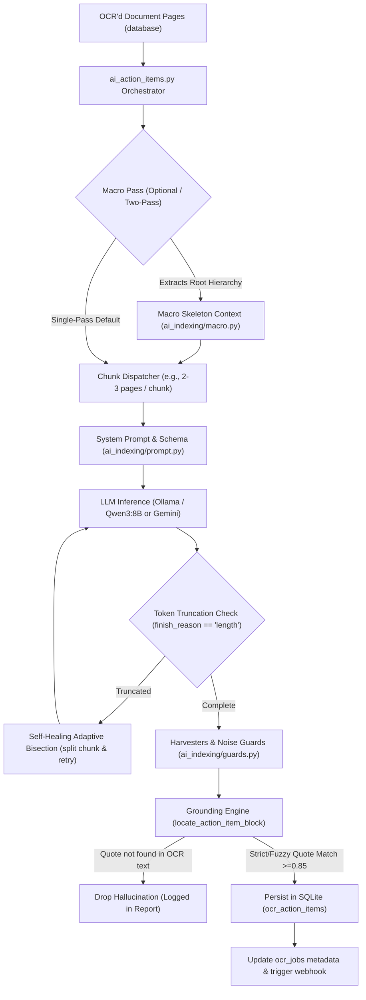

# Action Items Extraction System — Architecture, Pipeline, and Gold Benchmark Overview (Reviewed)

**Review date:** 2026-10-30

---

## Executive Summary

The extraction pipeline itself — chunking, grounding, classification, and persistence — is solid. The LLM-constrained schema, self-healing adaptive bisection, and 0.85-threshold grounding engine together form a well-designed anti-hallucination stack. The two benchmark documents provide realistic coverage for legal and procurement domains.

**However, the document describes a data-extraction system, not an action-management system.** The stated goal — "immediate operational visibility into actionable covenants, critical deadlines, qualification criteria, and binding outcomes" — implies that extracted items become *live, tracked, workable obligations*. The current design stops at the database row. Four significant gaps prevent the extracted data from fulfilling that goal:

| # | Severity | Gap | Impact |
|---|---|---|---|
| 1 | **High** | No tracking ticket integration | Extracted items sit in SQLite with no path to assignment, ownership, status tracking, or notification |
| 2 | **High** | Recurring actions have no recurrence schema | A "weekly progress report" obligation is stored identically to a one-time deadline — no scheduler, no `rrule`, no next-occurrence logic |
| 3 | **High** | Procedure/format references not captured | "As per Annexure B format" is swallowed into `item_text` with no link to the referenced format or sequence of steps |
| 4 | **High** | No eval plan beyond two anecdotal examples | The 99.7%–100% grounding rate is the only metric; no precision/recall, no classification accuracy, no negative test cases, no regression suite |
| 5 | **Medium** | Mandatory vs. optional fields not distinguished | All seven schema fields are listed without required/optional markers — implementers cannot determine valid vs. invalid rows |

**Recommended immediate actions (pre-implementation):**
1. Add a `recurrence` sub-schema to `AIActionItemChunk` covering `rrule`/`frequency`/`interval`/`anchor_event` for recurring obligations.
2. Add a `procedure_ref` field capturing cross-references to formats, annexures, or multi-step processes.
3. Define the ticket integration model — either via the existing webhook or a new export endpoint — with field mappings.
4. Write a formal eval rubric covering extraction recall, classification precision, date normalization, and negative-case suppression before running further benchmarks.
5. Mark mandatory fields explicitly in the schema definition.

None of these require changing the core extraction engine. They are schema extensions and downstream integration specs that should be locked in before the first production job runs.

---

## 1. What Are Action Items?

In legal, commercial, and government procurement documents, raw textual OCR and hierarchical document structure (chapters, sections, sub-clauses) are only the foundation. Users need immediate operational visibility into actionable covenants, critical deadlines, qualification criteria, and binding outcomes.

The **Action Items Extraction** pipeline identifies, classifies, extracts, and grounds these operative items into a structured taxonomy:

| Item Type | Definition | Typical Examples |
| :--- | :--- | :--- |
| **`deadline`** | An action that must be taken on or before a calendar date or within an elapsed timeframe relative to an anchor event. | Bid submission cutoff, pre-bid meeting date/time, LOA acceptance window ("within 30 days of LOA"), Bank Guarantee expiry. |
| **`obligation`** | A mandatory affirmative duty, compliance requirement, or qualification standard imposed on a responsible party. | Financial turnover thresholds (e.g. ₹100 Cr average turnover), positive net worth, non-blacklisting covenants, consortium registration rules. |
| **`condition`** | A contingency, prerequisite, penalty, or rule governing what happens if an event occurs. | Liquidated damages (0.5% per week up to 10%), stage penalties for milestone shortfalls, key date rollover on public holidays. |
| **`other`** | Operative procedural actions specific to adjudicatory/judicial documents that do not fit standard commercial contracts. | Applications for stay of arbitral awards, prayer for interim relief, trial court disposition orders ("petition dismissed with costs"), court registry directions. |

> **REVIEWER NOTE — Taxonomy: partially sound, but `obligation` conflates one-time and recurring duties.**
>
> **Reason for comment:** The `obligation` type as defined covers both one-time duties ("bidder must have positive net worth") and recurring duties ("contractor shall submit weekly progress reports"). These are operationally different: one-time obligations are checked once; recurring obligations require scheduler entries that fire on a cadence. Lumping them together means the downstream system cannot distinguish between a static eligibility criterion and a repeating workflow trigger.
>
> **Blocker:** Without a sub-type or recurrence flag, the extraction pipeline cannot drive scheduling for recurring obligations. A "weekly progress report" obligation extracted with `item_type: "obligation"` is indistinguishable from "positive net worth" — both are static rows. No scheduler can act on it correctly.
>
> **Actions that can be taken:**
> - Add a `recurrence` sub-schema (see §2.2 recommendation).
> - Add a fifth item type, `recurring_obligation`, distinct from one-time `obligation`.
> - Or add a `recurrence_pattern` field (`"weekly" | "monthly" | "milestone-triggered" | null`) to the existing schema.
>
> **Recommended action:** Add `recurrence_pattern` to the existing `obligation` type (not a new type — avoids classifier proliferation). When non-null, the item requires a scheduler entry in addition to a database row. Reason: a new type adds LLM classification complexity without adding information that a field already captures; a field is cheaper to add and extend.

---

## 2. End-to-End System Architecture

The action items pipeline is completely decoupled from the document-structure hierarchy. While structure indexing builds a tree of parent-child sections (`reference_index.py`), action items form a flat, page-indexed set of grounded obligations persisted in `ocr_action_items`.

> **REVIEWER NOTE — Architecture: extraction flow is sound; downstream flow is a stub.**
>
> **Reason for comment:** The flowchart ends at "Update ocr_jobs metadata & trigger webhook" (node N). The webhook is the only signal that extracted items are ready — but there is no specification of:
> - What the webhook payload contains (full item set? a count? a job_id for the consumer to fetch?)
> - What the consumer is expected to do with the webhook (create tickets? send notifications? trigger a scheduler?)
> - What happens if the webhook endpoint is unavailable (retry policy? dead-letter queue?)
>
> The architecture diagram shows a complete extraction pipeline but an incomplete consumption pipeline. For the stated goal of "operational visibility into actionable covenants," the consumption side is at least as important as the extraction side.
>
> **Blocker:** Without a specified consumption model, the system delivers rows to a SQLite table that no downstream process is specified to read. The webhook is a signal without a receiver contract.
>
> **Actions that can be taken:**
> - Define a ticket integration module (§2.5 or a new §2.6) specifying the webhook payload schema and the field mapping from `ocr_action_items` to a ticket system (Jira, Linear, GitHub Issues, or a bespoke internal tracker).
> - Add a "Create Tracking Tickets" node to the flowchart between N and the final output.
> - Define retry/failure policy for the webhook.
>
> **Recommended action:** Add a `§2.6 Ticket Integration` section (see recommendation in Feedback §). The webhook payload should at minimum include `job_id`, `items_found`, and a URL to `GET /api/jobs/{job_id}/action_items` so the consumer can fetch the full structured set. Reason: shipping the full item set in the webhook creates a large payload that may fail delivery for dense documents; a reference URL is more reliable.

### 2.1 Chunking & Context Management

1. **Sliding Page Chunks**: Documents are processed in small page windows (typically 2–3 pages) configured via `AI_INDEX_CHUNK_PAGES`. Action items do not rely on hierarchical parent carries across chunk boundaries. If an item appears on an overlap page, the latest chunk's version supersedes it cleanly in the database ("last chunk wins").
2. **Self-Healing Adaptive Chunking**: Dense pages (e.g. Bill of Quantities, technical specification tables, detailed eligibility grids) can overflow the model's output token limit (`num_predict`). If an LLM response indicates truncation (`finish_reason == "length"`), the chunk dispatcher bisects the chunk into smaller sub-chunks and re-processes them independently.
3. **Macro Context Skeleton**: In large tenders, background descriptions use obligatory wording ("the contractor shall maintain...") that describes legacy operations rather than new bidding requirements. The two-pass macro skeleton injects high-level document headers into chunk prompts, providing the model with boundary awareness.

> **REVIEWER NOTE — Chunking: self-healing bisection is a good safeguard; overlap strategy has an unaddressed edge case.**
>
> **Reason for comment:** "Last chunk wins" on overlap pages is simple and correct for most items. However, consider an obligation that *spans* the overlap boundary — its `evidence_quote` may be split across two OCR pages. The grounding engine checks against a single page's text. A quote that starts on page N and ends on page N+1 (mid-sentence) will fail grounding on both chunks. The document doesn't address this.
>
> **Blocker (conditional):** Only a blocker if the benchmark documents contain cross-page obligations. Legal contract clauses regularly span page breaks. The 99.7% grounding rate may be understating drop rate if cross-page items are simply never extracted rather than attempted and dropped.
>
> **Actions that can be taken:**
> - Extend the grounding engine to check the concatenation of page N and N+1 text when a quote fails single-page grounding.
> - Require `evidence_quote` to be ≤ one page in the prompt instructions.
> - Log how many items were dropped because of cross-page boundary failures (add a separate counter to the report).
>
> **Recommended action:** Log cross-page boundary failures separately. Require `evidence_quote` to be ≤ one page in the LLM prompt instructions — this is the simplest fix and costs nothing. Reason: prompting the model to keep quotes within a single page is cheap and avoids a complex grounding-engine extension.

### 2.2 Prompt Engineering & Structured Contract

The model is constrained by a strict JSON schema (`AIActionItemChunk`):
- `item_type`: Restricted to `"deadline" | "obligation" | "condition" | "other"`.
- `item_text`: A concise summary of the action required.
- `date_text`: The raw date or timeframe string (e.g. `"29.09.2026 up to 15:00 Hrs."` or `"within 18 months"`).
- `date_iso`: Normalized ISO-8601 date (`YYYY-MM-DD`) when an absolute calendar date is present.
- `anchor_event`: The triggering event when a date is relative (e.g. `"signing of contract"`, `"issue of LOA"`).
- `evidence_quote`: **Verbatim text snippet** from the OCR content demonstrating where the item originated.
- `responsible_party`: Entity bound by the item (e.g. `"Bidder"`, `"Contractor"`, `"Appellant"`, `"Employer"`).
- `confidence`: `"high" | "medium" | "low"`.

> **REVIEWER NOTE — Schema: three gaps: mandatory field marking, missing recurrence sub-schema, missing procedure/format reference field.**
>
> **Reason for comment (mandatory fields):** All eight fields are listed without required/optional designation. Implementers, validators, and downstream consumers cannot determine what constitutes a valid row. For example:
> - Is `date_text` required for `deadline`? (Presumably yes — a deadline without any date text is not a deadline.)
> - Is `anchor_event` required when `date_iso` is absent? (Presumably yes, but not stated.)
> - Is `responsible_party` always required? What is the valid value when the text is ambiguous?
> - Is `confidence: "low"` filtered out before persistence, or persisted and filtered downstream?
>
> **Blocker:** Without mandatory field rules, the schema cannot be validated server-side, and downstream systems consuming `ocr_action_items` cannot rely on field presence. A ticket system trying to set an assignee from `responsible_party` will fail unpredictably on null values.
>
> **Reason for comment (recurring obligations):** There is no `recurrence_pattern` or `recurrence_rrule` field. A contract clause like "the Contractor shall submit monthly progress reports throughout the contract period" cannot be stored in a form that a scheduler can consume. It is stored identically to "the bidder must have positive net worth" — both are `obligation` rows with a null `date_iso`.
>
> **Reason for comment (procedure references):** Contracts frequently reference procedures, formats, and annexures: "as per Annexure B format," "following the procedure in Schedule 4," "using Form GFR-23." These cross-references are swallowed into `item_text` prose with no structured field. A user following up on an obligation cannot click to the referenced format; the connection is lost. The cross-reference navigation design (already built) could surface these links — but only if they are captured as a field.
>
> **Actions that can be taken:**
> - Mark required/optional on each field in the schema definition.
> - Add `recurrence_pattern: string | null` — RFC 5545 `RRULE` fragment or plain-text descriptor (`"monthly" | "weekly" | "per-milestone"`).
> - Add `procedure_ref: {type: "annexure"|"schedule"|"form"|"clause", ref_key: string} | null` — capturing the referenced format/procedure as a structured key that `reference_index.py` can resolve.
> - Add `recurrence_anchor: string | null` — the contract duration event that bounds a recurring obligation (e.g. `"throughout the contract period"`).
>
> **Recommended action:** Add three fields now: `recurrence_pattern` (nullable string), `procedure_ref` (nullable object), and mark required/optional on all existing fields. Reason: these fields must be in the LLM prompt schema — retrofitting them after production runs means re-processing all documents. The cost of adding them before first run is near zero; the cost after is full reprocessing.
>
> **Proposed mandatory field matrix (to be confirmed):**
>
> | Field | `deadline` | `obligation` | `condition` | `other` |
> |---|---|---|---|---|
> | `item_type` | Required | Required | Required | Required |
> | `item_text` | Required | Required | Required | Required |
> | `evidence_quote` | Required | Required | Required | Required |
> | `responsible_party` | Required | Required | Required | Required |
> | `confidence` | Required | Required | Required | Required |
> | `date_text` | Required | Optional | Optional | Optional |
> | `date_iso` | Conditional* | — | — | — |
> | `anchor_event` | Conditional* | Optional | Optional | — |
> | `recurrence_pattern` *(new)* | — | Optional | — | — |
> | `procedure_ref` *(new)* | Optional | Optional | Optional | — |
>
> *`date_iso` required when date is absolute; `anchor_event` required when `date_iso` is absent (relative deadline). At least one of these two must be present for every `deadline` item.

### 2.3 Noise Guards and Harvesters

To prevent flooding the output with boilerplate legalese:
- **Noise Guards (`ai_indexing/guards.py`)**: Filter out historical recitals, statutory preambles, standard court appearances, and non-actionable definitions. Suppress repetitive page headers, footers, and generic tender disclaimers.
- **Rule Harvesters (`ai_indexing/harvesters.py`)**: Provide deterministic pattern matching for key dates (NIT bid submission windows, pre-bid meeting stamps) and financial figures to augment LLM recall.

> **REVIEWER NOTE — Noise guards: existence confirmed but specification thin.**
>
> **Reason for comment:** The guards and harvesters are described by name and general function but with no specification of:
> - What patterns the guards match (regex? a list of phrases? ML classifier?)
> - How "historical recitals" are distinguished from active obligations in ambiguous cases (a "Whereas" clause that includes an active payment obligation, for example)
> - What the harvesters produce — do they add items directly to `ocr_action_items` bypassing the LLM, or do they inject context into the prompt, or both?
> - Whether harvester-sourced items go through grounding verification (they should, since a harvested date pattern from a header could be a page-number false positive)
>
> **Blocker (conditional):** If harvesters bypass grounding, their outputs are unverified and could introduce false positives. The document implies grounding is universal ("every candidate action item returned by the LLM must pass strict grounding") — but harvesters are not the LLM. Clarify whether harvester items are grounded.
>
> **Actions that can be taken:**
> - Specify guard patterns explicitly (even a representative list).
> - Clarify harvester output path: do they produce `AIActionItemChunk`-compatible objects that go through the same grounding path, or bypass it?
> - Add a dedicated "items_added_by_harvester" counter to the job report so recall from harvesters vs. LLM is separable.
>
> **Recommended action:** Require all items — harvester and LLM — to pass through the same grounding engine. Reason: harvesters pattern-match against raw OCR text, which has known noise (headers OCR'd as `ll`, `l3`, etc.). Grounding at 0.85 threshold is cheap and catches false positives from both sources.

### 2.4 Grounding Verification (Hallucination Prevention)

Every candidate action item returned by the LLM must pass strict grounding in `locate_action_item_block`:
1. The candidate's `evidence_quote` is normalized: HTML entities are decoded, whitespace is unified, and typographic quotes are flattened.
2. The engine scans the OCR word blocks for that page:
   - **Exact Substring Match**: Finds the exact sequence of words.
   - **Fuzzy difflib Match ($\ge 0.85$ similarity)**: Accommodates minor OCR character artifacts.
3. **Rejection Rule**: If an evidence quote cannot be grounded against the actual page text, it is **dropped immediately** as an ungrounded hallucination. This mechanism maintains a **99.7%–100% Grounding Rate** in benchmark runs.

> **REVIEWER NOTE — Grounding: mechanism is sound; the "99.7%–100% Grounding Rate" metric needs redefinition.**
>
> **Reason for comment:** "Grounding Rate" as stated measures the fraction of *extracted* items that could be grounded. This is a precision-of-extraction metric, not a recall metric. A system that extracts only one item per document would achieve 100% grounding rate if that one item is real — but would miss dozens of obligations. The metric says nothing about how many extractable obligations were missed.
>
> **Blocker:** Reporting only grounding rate gives a misleading picture of system quality. A pipeline tuned to extract conservatively (few items, all grounded) could score 100% grounding rate while missing 40% of actual obligations.
>
> **Actions that can be taken:**
> - Define and measure extraction recall against a human-labeled gold set for each benchmark document.
> - Define extraction precision (items extracted that a human annotator agrees are genuine obligations).
> - Separate the grounding metric clearly: "of items the LLM proposed, X% were groundable" — this is useful but distinct from "of obligations present in the document, X% were found."
> - Report the drop count (items_dropped_ungrounded) as a fraction of total proposed, not of total persisted.
>
> **Recommended action:** Commission a human annotation pass on both benchmark documents (100-page legal + 135-page tender) to create a gold standard. Measure recall and precision against it. The grounding engine already provides one input to precision; recall requires the gold set. Without this, the "99.7%–100%" claim is not comparable across models, prompt changes, or document types. Reason: this is the minimum viable eval for a system handling legal obligations where a missed deadline has real consequences.

### 2.5 Storage and Persistence

- Results are stored in the `ocr_action_items` table:
  - Indexed by `job_id`, `page`, `item_type`, and `occurrence_index`.
  - Includes normalized `date_iso`, `responsible_party`, and block bounding box coordinates when available.
- Job-level summary metrics (`items_found`, `items_dropped_ungrounded`, `duration_seconds`) are saved directly into `ocr_jobs.action_item_report`.

> **REVIEWER NOTE — Storage: schema is minimal; three columns needed for downstream consumption.**
>
> **Reason for comment:** The persisted schema (inferred from this section and §2.2) does not include:
> 1. **`ticket_id`**: If/when a ticket is created from this item, there is no foreign key back to the external ticket. Re-runs would create duplicate tickets with no way to detect they already exist.
> 2. **`status`**: The item's current state (`open | acknowledged | completed | waived`). Without status, the table is an append log, not a live obligation tracker.
> 3. **`recurrence_pattern` / `procedure_ref`**: As noted in §2.2, these must be persisted if they are extracted.
>
> **Blocker:** Without `status` and `ticket_id`, the `ocr_action_items` table cannot serve as an action tracker. It can only be a read-once extraction log. Every obligation remains perpetually "open" with no way to record resolution.
>
> **Actions that can be taken:**
> - Add `ticket_id TEXT NULL` to `ocr_action_items` — populated when the webhook consumer creates a ticket.
> - Add `status TEXT DEFAULT 'open'` with a defined enum.
> - Add `recurrence_pattern TEXT NULL` and `procedure_ref TEXT NULL` columns.
> - Add a `UNIQUE` constraint on `(job_id, evidence_quote_hash)` to prevent duplicate items on re-runs.
>
> **Recommended action:** Add `ticket_id`, `status`, and the two new schema fields before the table is deployed. A schema migration on a live table is far more disruptive than adding columns before first use. Reason: `status` tracking is the minimum for the system to be called an "action tracker" rather than an "extraction log."

---

## 3. Examples of Extracted Action Items

> [!NOTE]
> **Illustrative Sample Notice**: The examples highlighted below represent only a **small subpart / subset of the total action items** that the system extracts from these documents. In real-world processing, the system extracts dozens to hundreds of granular obligations, milestones, deadlines, and conditions across the complete span of these multi-page documents.

### Document 1: HVPNL Arbitration Appeal (100 Pages)

- **Dataset ID**: `appeal-100p`
- **Source Job ID**: `bb417471-561c-4029-bb21-3bdcf74e7dcb`
- **Domain**: Legal Judgment & Commercial Arbitration Appeal
- **Nature of Document**: Appellate court pleadings under Section 37 of the Arbitration and Conciliation Act, 1996, challenging an arbitral award arising from a power substation contract.

#### Representative Sample (Subset of Action Items):

##### 1. Operative Judicial Relief (`other`)
- **Page**: 10
- **Summary**: *Appellant applies to stay operation of the arbitral award and additional award*
- **Evidence Quote**: `"the operation of award dated 19.02.2017 and additional award dated 11.04.2017 passed by learned Arbitral Tribunal may kindly be stayed, in the interest of justice"`
- **Responsible Party**: Appellant — **Classification**: `other`

##### 2. Final Court Disposition (`other`)
- **Page**: 59
- **Summary**: *Court dismisses the objection petition with costs (disposition event)*
- **Evidence Quote**: `"the objection petition is hereby dismissed with costs"`
- **Responsible Party**: Court — **Classification**: `other`

##### 3. Judicial Registry Record Retention (`other`)
- **Page**: 59
- **Summary**: *Registry directed to retain arbitration record until limitation period for appeal/revision expires*
- **Evidence Quote**: `"the arbitration record be kept till the expiry of limitation period of appeal/revision and thereafter, be sent back to the concerned arbitrator"`
- **Responsible Party**: Court Registry — **Classification**: `other`

##### 4. Relative Milestone Deadline (`deadline`)
- **Page**: 65
- **Summary**: *Testing & commissioning of sub-stations due within 18 months of contract signing*
- **Date Text**: `"within 18 months from date of signing of contract"` — **Anchor Event**: `"date of signing of contract"`
- **Evidence Quote**: `"the testing and commissioning of all the sub-stations is completed within 18 months from the date of signing of contract as per clause 11 SCC"`
- **Responsible Party**: Contractor — **Classification**: `deadline`

##### 5. Fixed Bank Guarantee Expiry Date (`deadline`)
- **Page**: 67
- **Summary**: *Bank guarantee claim must be lodged with bank on/before fixed date*
- **Date Text**: `"on or before 20.02.2011"` — **Normalized Date ISO**: `2011-02-20`
- **Evidence Quote**: `"The Guarantee is conditional on a claim being lodged with us at our counters on or before 20.02.2011"`
- **Responsible Party**: Citibank N.A. — **Classification**: `deadline`

##### 6. Contractual Liquidated Damages Condition (`condition`)
- **Page**: 87
- **Summary**: *Liquidated damages of 0.5% of contract price per delayed portion, capped at 10%*
- **Evidence Quote**: `"Half percent (0.5 %) of the contract price for the delayed portion of the work delivery part there of subject to a maximum of 10% of the contract value"`
- **Responsible Party**: Contractor — **Classification**: `condition`

> **REVIEWER NOTE — Document 1 examples: two gaps visible in the samples.**
>
> **Gap A — Procedure references not captured:**
> Item #4 contains `"as per clause 11 SCC"` in its evidence quote. This is a cross-reference to a specific contract clause (Schedule of Conditions of Contract, clause 11) that defines *how* the testing and commissioning must be performed. The `item_text` summarizes what must be done; the referenced clause specifies the procedure. With the current schema, this cross-reference is invisible to the consumer. A user tracking this obligation cannot navigate to the referenced procedure.
>
> **Gap B — Recurring obligation example absent:**
> The arbitration appeal document is unlikely to contain recurring obligations (it is a judicial pleading, not an active contract). However, the underlying contract from which this appeal arose almost certainly has recurring obligations (monthly progress reports, quarterly payments, periodic inspections). These may appear cited within the pleading text. The sample does not show whether the extractor handles or ignores recurring pattern text when it appears in a judicial context.
>
> **Actions:** Add `procedure_ref` capture (see §2.2). For Document 1, the extractor should capture `{type: "clause", ref_key: "clause:11-SCC"}` for item #4. This ref_key is directly resolvable via the `reference_index.py` cross-reference system already designed.

### Document 2: MPPKVVCL Commercial Tender (135 Pages)

- **Dataset ID**: `tender-135p`
- **Source Job ID**: `89cfa529-2390-464c-9c3e-2446ef68c588`
- **Domain**: Government Commercial Procurement & ERP Implementation Tender

#### Representative Sample (Subset of Action Items):

##### 1. Critical Tender Schedule Milestones (`deadline`)
- **Page**: 5 — **Date Text**: `"29.09.2026 up to 15:00 Hrs."` — **ISO**: `2026-09-29`
- **Evidence Quote**: `"Due date of submission of Tender (EMD in Cover-1 + Techno-Commercial Bid in Cover-2)</td><td>29.09.2026 up to 15:00 Hrs."`
- **Responsible Party**: Bidder — **Classification**: `deadline`

##### 2. Public Tender Bid Opening Date (`deadline`)
- **Page**: 5 — **Date Text**: `"30.10.2026 15:30 Hrs."` — **ISO**: `2026-10-30`
- **Evidence Quote**: `"Bid Opening Date</td><td></td><td>30.10.202615:30 Hrs."`
- **Responsible Party**: Tender Committee / MPPKVVCL — **Classification**: `deadline`

##### 3. Relative Tender Validity Period (`deadline`)
- **Page**: 7 — **Date Text**: `"180 days"` — **Anchor Event**: `"date of Opening of Tender"`
- **Evidence Quote**: `"TENDER validity period (in days)</td><td>180 days (from the date of Opening of Tender)"`
- **Responsible Party**: Bidder — **Classification**: `deadline`

##### 4. Financial Eligibility Threshold (`obligation`)
- **Page**: 8 — **Date Text**: `"last three financial years ending 31st March 2026"` — **ISO**: `2026-03-31`
- **Evidence Quote**: `"Minimum Average Annual Turnover in the last three financial years ending 31st March 2026 should be INR 100 Cr. from Information Technology Business and Services"`
- **Responsible Party**: Bidder — **Classification**: `obligation`

##### 5. Net Worth Requirement (`obligation`)
- **Page**: 8 — **Date Text**: `"31-03-2026"` — **ISO**: `2026-03-31`
- **Evidence Quote**: `"must have positive net worth during last all three (03) financial years ending 31-03-2026."`
- **Responsible Party**: Bidder — **Classification**: `obligation`

##### 6. Integrity and Non-Blacklisting Covenant (`obligation`)
- **Page**: 8
- **Evidence Quote**: `"The Sole bidder/Lead bidder and Consortium Partner (in case of consortium) should not have been blacklisted by any entity of GoMP for being involved in corrupt or fraudulent practices as on date of issue of NIT."`
- **Responsible Party**: Bidder / Consortium Partner — **Classification**: `obligation`

##### 7. Technical Experience Requirement (`obligation`)
- **Page**: 9
- **Evidence Quote**: `"The Sole bidder/Lead bidder must have executed at least 3 Oracle ERP-EBS Implementation/Upgrade/O&M projects for Central/State Govt. or PSUs in India during past 10 years."`
- **Responsible Party**: Bidder — **Classification**: `obligation`

##### 8. Calendar Contingency Rule (`condition`)
- **Page**: 6
- **Evidence Quote**: `"In case of any of above dates is declared as holiday / local holiday then the date will be shifted to next working day."`
- **Responsible Party**: All Parties — **Classification**: `condition`

##### 9. Consortium Governance Rule (`obligation`)
- **Page**: 10
- **Evidence Quote**: `"the Consortium shall comprise not more than two members and its composition shall not be changed after bid submission or during the Contract without prior written approval of MPPKVVCL"`
- **Responsible Party**: Consortium — **Classification**: `obligation`

> **REVIEWER NOTE — Document 2 examples: three gaps visible; one critical.**
>
> **Gap A — Recurring obligations absent from sample:** A 135-page ERP implementation tender almost certainly contains recurring obligations in the implementation and O&M sections. Examples that would be typical: monthly SLA reports to MPPKVVCL, quarterly performance reviews, annual license renewal deadlines, helpdesk response-time SLAs with weekly measurement windows. None appear in the sample. This may be because: (a) the sample is a subset and they are present elsewhere; (b) the extractor classifies them as `obligation` without recurrence fields and they are in the DB; or (c) they are suppressed by the macro skeleton context (mistaken for background legacy operations). Whichever is true, the sample should include at least one recurring obligation to validate the extractor's behavior on this case.
>
> **Gap B — Procedure/format references absent:** A tender of this nature typically references: submission formats (Cover-1 / Cover-2 structure implied by item #1), EMD format, technical bid format, financial bid format, bank guarantee format. Item #1's evidence quote references "EMD in Cover-1 + Techno-Commercial Bid in Cover-2" — this is a procedure reference that should be captured as `procedure_ref: {type: "format", ref_key: "Cover-1"}`. Not captured in the current schema.
>
> **Gap C — HTML table artifacts in evidence_quote (observable bug):** Item #2's evidence_quote contains raw HTML: `"Bid Opening Date</td><td></td><td>30.10.202615:30 Hrs."` — the `</td><td>` tags are OCR artifacts from a table that was rendered as HTML. More critically, `"30.10.202615:30 Hrs."` is missing a space between the date and time (the cell boundary ate the space). The grounding engine passes this because the evidence_quote matches the OCR text (which also has this artifact). But the `date_text` field should be `"30.10.2026 15:30 Hrs."` (with space) and the ISO should be `2026-10-30` — confirmed correct here, but the normalization step must not be relying on raw evidence_quote text to extract the date. Confirm that `date_iso` normalization uses `date_text` (LLM-cleaned), not `evidence_quote` (raw OCR). This should be specified in §2.2.
>
> **Actions:** (A) Include at least one recurring obligation example in the benchmark set, even if sourced from a different document section. (B) Add `procedure_ref` field. (C) Add a note in §2.2 that `date_iso` is normalized from `date_text`, not from `evidence_quote`; add this as a test case in the eval plan.

---

## 4. Summary Matrix of Evaluated Benchmarks

| Document Name | Dataset ID | Pages | Primary Domain | Dominant Item Types | Key Extraction Focus |
| :--- | :--- | :---: | :--- | :--- | :--- |
| **HVPNL Arbitration Appeal** | `appeal-100p` | 100 | Legal Judgment / Appellate Court | `other`, `condition`, `deadline` | Judicial prayers, stay applications, court disposition orders, arbitral penalty conditions, record retention. |
| **MPPKVVCL Commercial Tender** | `tender-135p` | 135 | Commercial Tender / ERP Procurement | `deadline`, `obligation`, `condition` | Strict submission dates, turnover & net worth criteria, non-blacklisting covenants, consortium stability. |

> **REVIEWER NOTE — Benchmark matrix: two documents are insufficient for a production eval plan; no eval metrics defined.**
>
> **Reason for comment:** The benchmark section presents two documents as illustrative examples but frames them as if they constitute an evaluation suite ("extraction standards ensure the extraction pipeline is evaluated against real-world, complex legal and commercial documents"). They do not: the document does not specify:
> - How many items in each document were annotated by a human and considered ground truth?
> - What precision and recall were measured against that ground truth?
> - Were there negative test cases (items that look like obligations but should not be extracted)?
> - Were there adversarial cases (statute citations that should be excluded, background recitals that look like obligations)?
> - How was the 99.7%–100% grounding rate measured? (Total items proposed by LLM? Or only items that reached the grounding engine?)
> - What happens when a new model version (e.g. Qwen3:14B or Gemini 2.0) is used — is there a regression test?
>
> **Blocker:** Without a formal eval rubric, every model upgrade or prompt change requires manual re-review of outputs. There is no automated way to detect regressions. Legal obligation extraction has real consequences for missed items; the current eval posture is not sufficient for production use.
>
> **Actions that can be taken:**
> 1. Commission a human annotation pass on both documents — annotators mark every action item with its type, responsible party, and whether it is recurring. This becomes the gold standard.
> 2. Define metrics: **extraction recall** (gold items found / gold items total), **extraction precision** (extracted items correct / total extracted), **classification accuracy** (correct `item_type` / total classified), **date normalization accuracy** (correct `date_iso` / total dates present), **responsible party accuracy**.
> 3. Add negative test cases: a statutory preamble document, a definitions-only section, a document of only background recitals — the extractor should produce zero items on each.
> 4. Add a third benchmark document from a different domain (e.g. a construction EPC contract or a software SaaS agreement) to test generalization.
> 5. Automate the eval as a CI check: run extraction on the benchmark documents after every model or prompt change, compare against gold, fail if recall drops > 5% or precision drops > 10%.
>
> **Recommended action:** Prioritize human annotation of the two existing benchmarks before any further extraction runs. Reason: every item extracted without a gold set is unevaluated. The grounding rate (99.7%) is the only objective metric currently available, and it measures only one dimension of quality. Annotation of 100 and 135 pages is a bounded, one-time cost; the resulting gold set enables all future evaluations automatically.

---

## Feedback and Recommendations

### Finding #1 — High | §1, §2.2, §2.5

**Recurring actions have no recurrence schema — a weekly progress report is stored identically to a static net-worth requirement**

An ERP implementation contract or construction contract reliably contains recurring obligations: monthly SLA reporting, quarterly payment milestones, annual insurance renewal, weekly site inspection sign-offs. With the current schema, these are stored as `obligation` rows with no structured recurrence information. No scheduler can trigger on them; no ticket system can generate recurring tasks from them.

**Required action:** Add to `AIActionItemChunk` and `ocr_action_items`:
- `recurrence_pattern: string | null` — an RFC 5545 `RRULE` fragment or a plain-text descriptor: `"FREQ=WEEKLY"`, `"FREQ=MONTHLY"`, `"per-milestone"`, `"throughout-contract"`. The LLM should emit this when the obligation text contains frequency language ("monthly," "weekly," "quarterly," "each time," "every").
- `recurrence_anchor: string | null` — the contract event that starts/ends the recurrence window (e.g., `"date of commencement"` to `"date of completion"`).

**Why:** Recurring obligations are some of the highest-value items to track — a missed monthly report is a contract breach. Capturing them without recurrence information produces a system that alerts once and never again.

---

### Finding #2 — High | §2.2, §3 (both examples)

**Procedure and format references are not captured — cross-references to Annexures, Schedules, and Forms are swallowed into prose**

Contracts reference external formats and multi-step procedures constantly: "as per Form GFR-23," "following Schedule 4," "using the format at Annexure B." These references are actionable — the user following the obligation must locate and use the referenced document. Currently they are subsumed into `item_text` and invisible to downstream systems.

**Required action:** Add `procedure_ref: {type: "annexure"|"schedule"|"form"|"clause", ref_key: string} | null` to the schema. The `ref_key` should match the normalized key format used by `reference_index.py` (`"annexure:b"`, `"schedule:4"`, `"clause:11-SCC"`), enabling direct link resolution via the existing cross-reference system.

**Why:** The cross-reference navigation feature (already designed) can surface the referenced procedure in a popover or link — but only if the reference is a structured field, not buried in prose.

---

### Finding #3 — High | §2, §2.5

**No tracking ticket integration specified — extracted items have no path to assignment, ownership, or status tracking**

The pipeline ends at a SQLite row and a webhook signal. The webhook payload is unspecified; no ticket system integration is defined; the `ocr_action_items` table has no `status` column and no `ticket_id` foreign key. The system extracts actionable items but provides no mechanism to track their resolution.

**Required action:** Add a `§2.6 Ticket Integration` section specifying:
- Webhook payload: `{job_id, items_found, fetch_url}` — not the full item set, a reference URL.
- Consumer behavior: poll `GET /api/jobs/{job_id}/action_items`, create one ticket per item, populate fields from the item schema.
- Field mapping: `item_text` → ticket title; `responsible_party` → assignee; `date_iso` → due date; `evidence_quote` → ticket description body; `recurrence_pattern` → recurring task rule.
- Idempotency: `ticket_id` stored back in `ocr_action_items` to prevent duplicate tickets on re-runs.
- Add `status TEXT DEFAULT 'open'` and `ticket_id TEXT NULL` columns to `ocr_action_items`.

**Why:** Without status tracking, the system cannot distinguish a resolved obligation from a pending one. The table becomes a static extraction log, not a live action tracker.

---

### Finding #4 — High | §2.4, §4

**No formal eval plan — the 99.7%–100% grounding rate is the only metric, and it measures only one dimension**

Grounding rate (fraction of proposed items that could be verified in OCR text) is a precision-of-grounding metric. It does not measure: how many real obligations were missed (recall), whether the `item_type` classification was correct, whether `date_iso` normalization was accurate, or whether recurring obligations were captured. There are no negative test cases, no regression tests, and no gold standard.

**Required action:** Before the next benchmark run:
1. Human-annotate both documents: every action item, its type, recurrence, and responsible party.
2. Define and measure: extraction recall, extraction precision, `item_type` accuracy, `date_iso` accuracy, negative-case suppression rate.
3. Add negative test case documents: definitions-only sections, statutory preambles, background recitals.
4. Add a third benchmark document from a different domain (EPC contract or SaaS agreement).
5. Automate as CI: run on benchmarks after every model or prompt change; fail on ≥5% recall drop or ≥10% precision drop.

**Why:** Legal obligation extraction has real consequences for missed items. A missed commissioning deadline or a missed payment milestone cannot be recovered with a "well, grounding rate was 99.7%" explanation. The eval must measure what matters: did the system find the obligations that were there?

---

### Finding #5 — Medium | §2.2

**Mandatory vs. optional fields not distinguished — implementers and validators cannot determine valid rows**

All eight schema fields are listed without required/optional markers. Without this, the schema cannot be validated server-side, and downstream consumers (ticket systems, schedulers) cannot rely on field presence.

**Required action:** Mark each field required/optional per `item_type` (proposed matrix in §2.2 reviewer note above). Add server-side validation that rejects items missing required fields before the grounding check. Log rejected items as a separate counter in the job report (`items_dropped_schema_invalid`).

**Why:** A ticket system that tries to read `date_iso` for deadline items will encounter nulls for items that should always have a date, with no way to know if the null is valid (relative deadline with `anchor_event`) or a bug (LLM omitted the field). Required/optional marking converts a runtime surprise into a schema contract violation caught at ingest time.
