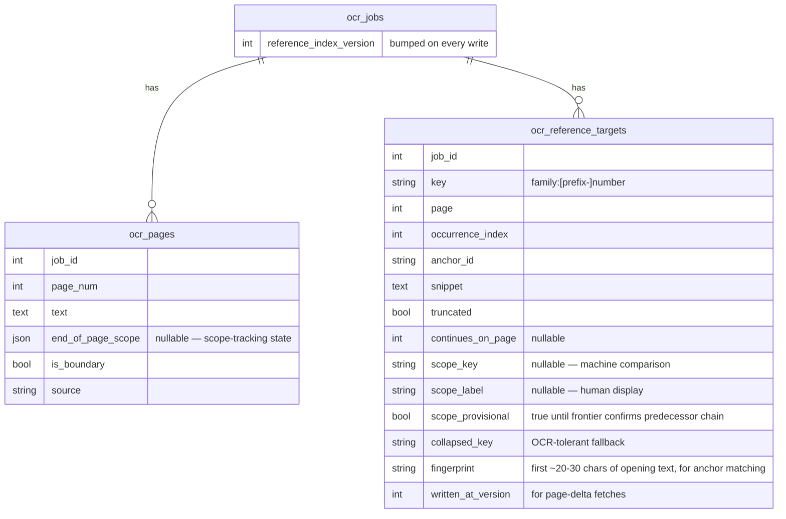
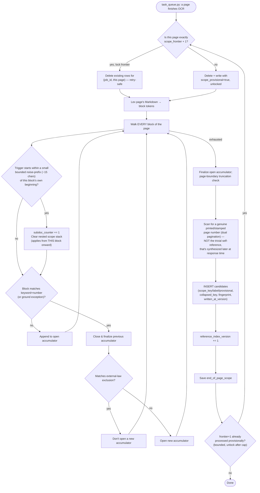
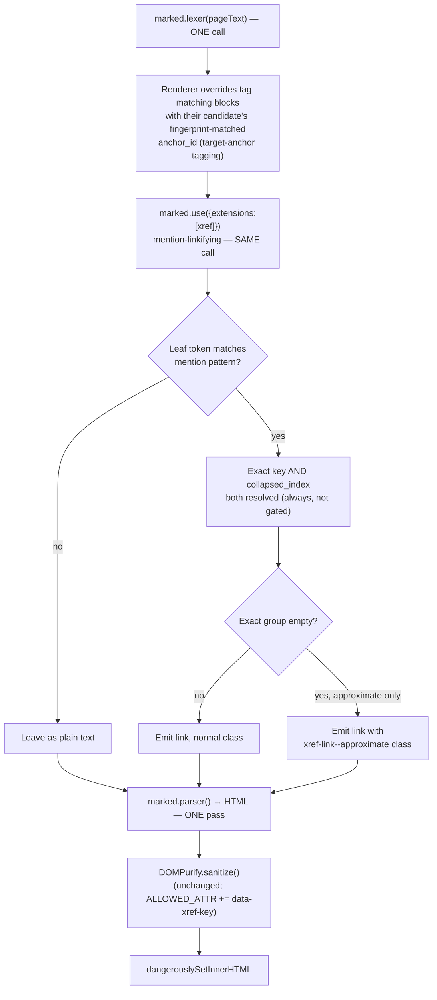
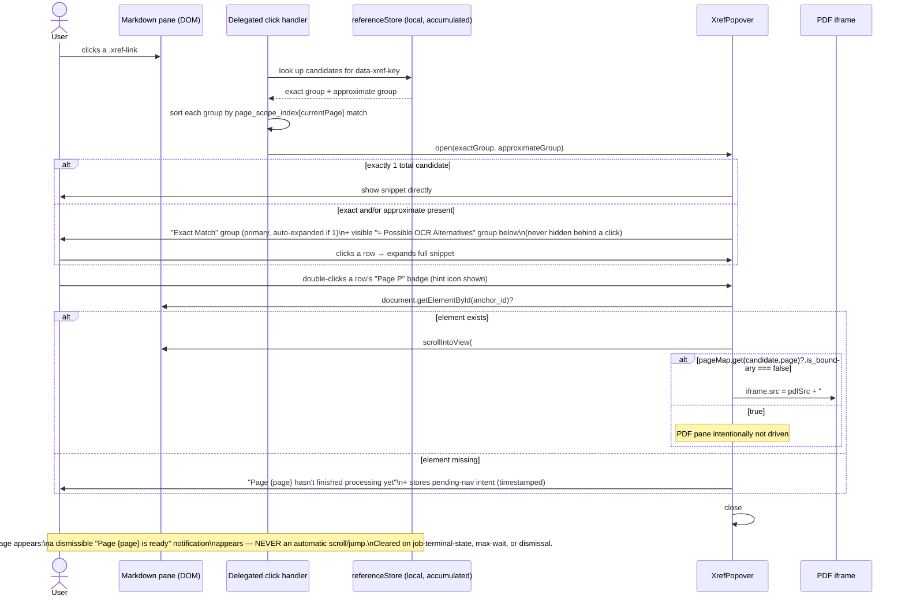

# In-Document Cross-Reference Navigation — Technical Design Document

**Status:** Design finalized across four review rounds — pending implementation approval
**Source plan:** `~/.claude/plans/this-is-a-project-eventual-lamport.md`
**Scope of this document:** the cross-reference detection/resolution algorithm and its integration into the existing OCR pipeline and viewer. **The detection algorithm runs server-side**, computed once per job and cached; the frontend is a thin consumer that renders links and a popover from data it's given (see [§1.2](#12-architecture-decision-backend-detection-thin-frontend)).

**Revision history:**
- *Round 1* found five gaps (collapsed-key collisions, undefined scope-label derivation, a silent cross-page navigation failure, an unreachable `is_boundary` flag, an unspecified wire format).
- *Round 2*, stress-testing round 1's fixes, found nine further issues — several of round 1's own fixes had introduced new problems (noisy collapsed-key suggestions, a leading-blocks-only sub-document check, multi-megabyte poll payloads, unnecessary `is_boundary` denormalization, client/server-split `page:N` generation).
- *Round 3* found that several round-2 fixes were themselves incomplete: the collapsed-key suppression traded noise for silent misdirection; the frontier-based out-of-order handling had no concurrency control; the `<150 char` sub-document heuristic failed in both directions on real filings; the pending-navigation fix caused unprompted viewport hijacking; `is_boundary` access used ambiguous/wrong array notation; the wire-format split didn't help during active processing; and cross-lexer anchor-id parity was fragile.
- *Round 4* refined the round-3 collapsed-key fix further: rather than hiding a genuine OCR-collision alternative behind an opt-in link, it's now always shown, stratified into a primary "Exact Match" group and a visible (never click-gated) "Possible OCR Alternatives" group, plus a pre-click visual cue on the rendered link itself.

This document reflects the fully-converged, round-4 state.

---

## 1. Overview

### 1.1 Problem statement

When a scanned PDF is OCR'd, the app shows the original PDF (a plain `<iframe>`) next to the extracted Markdown text. When that text contains an internal reference — "see clause 2," "Annexure A1 to A5," "para 2, line 10" — the reader has no way to jump to the referenced content in place. They must manually search the PDF (a scanned image, not searchable) or scroll the Markdown pane, read the passage, and find their way back. This is expensive precisely in the documents this tool targets: contracts, and — validated against real 25-page and 100-page samples of the same 900+ page Indian High Court paper book — multi-hundred-page legal filings that bundle a petition, a lower-court judgment, and several annexed contracts into one file.

**Goal:** detect such references automatically, and let the reader see the referenced content immediately — reading it in place for a quick check, or jumping to it deliberately — without losing where they were.

### 1.2 Architecture decision: backend detection, thin frontend

An earlier draft put the entire algorithm in the browser, reasoning that the full page text is already shipped to the frontend anyway. "Works retroactively without reprocessing" and "don't touch the fragile OCR pipeline" — the two real justifications — are both satisfied just as well by a backend design that computes lazily/incrementally and caches. Doing the analysis client-side also caused real, avoidable complexity: time-sliced processing and generation-counter cancellation to keep a large cross-page computation from blocking the browser's main thread, and a shared/global JS templating-library state-leak risk.

**Decision:** the expensive, cross-page, correctness-sensitive analysis is business logic, and belongs in the service layer. The frontend's job is what a frontend's job should be: render what it's given, and react to clicks.

---

## 2. System Context

```mermaid
flowchart LR
    subgraph Backend["Backend (new, additive)"]
        TQ["task_queue.py\n(existing async job pipeline)"]
        RI["reference_index.py\n(new — Phase A algorithm)"]
        DB[("ocr_reference_targets\n(new table)")]
        API1["GET /api/jobs/{id}\n(existing, gains ONE cheap field:\nreference_index_version)"]
        API2["GET /api/jobs/{id}/references\n?since_version=V\n(new — page-delta, not full snapshot)"]
    end

    subgraph Frontend["Frontend (thin — render + react)"]
        DASH["Dashboard.jsx\n(existing 2.5s poll — unchanged)"]
        STORE["referenceStore.js\n(accumulates deltas into a\npersistent local index)"]
        MD["markdown.js\nPhase B — anchor-tagging +\nmention-linkifying, ONE lex pass"]
        VIEWER["ViewerPanel.jsx"]
        POP["XrefPopover.jsx\nPhase C — stratified candidate UI"]
        FILE["PDF iframe\n(existing, #page=N navigation)"]
    end

    TQ -->|"on each page completion\n(upsert_page already happens here);\nconcurrency-safe, bounded cascade\nfor out-of-order pages"| RI
    RI -->|writes candidates + scope state\n+ bumps reference_index_version| DB
    DB -->|read| API1
    DB -->|"read, delta only\n(changed pages since V)"| API2
    API1 -->|pages_data + reference_index_version| DASH
    DASH -->|version changed?| API2
    API2 -->|page deltas| STORE
    STORE -->|accumulated index| VIEWER
    VIEWER -->|page text + index| MD
    MD -->|HTML with .xref-link\n(+ approximate modifier class)\nand target-anchor ids| VIEWER
    VIEWER -->|click .xref-link| POP
    POP -->|scroll + set #page=N| FILE
```

No new frontend dependency. No changes to `unlimited_ocr_engine.py`, `gpu_ocr_client.py`, `chunking.py`, `seam_stitching.py`, `context_primer.py`, `confidence.py`, or the GPU OCR microservice.

---

## 3. Division of Responsibility

| Concern | Where | Why |
|---|---|---|
| Detecting **targets**; cross-page scope; cross-sub-document boundaries; external-statute exclusion; dual pagination; OCR-tolerant key matching | **Backend** | Cross-page, expensive, needs to run once and be shared/cached |
| Tagging **anchor ids** on rendered target blocks; detecting **mentions**; turning mentions into links | **Frontend** | Tied to the client's own token-tree rendering; cheap, one page at a time |
| Popover, candidate browsing, double-click-to-navigate, PDF `#page=` jump | **Frontend** | Pure display/interaction |

---

## 4. Data Model

### 4.1 `ocr_reference_targets`



**`is_boundary` is deliberately absent from this table** (§8.3 — the frontend reads it from `pages_data` instead). **`page:N` self-reference rows are deliberately absent too** — the trivial "every page is its own page:N target" fact is synthesized at API-response time, never persisted (§5.5).

| Column | Type | Notes |
|---|---|---|
| `job_id` | `TEXT`/`INTEGER` | Part of composite PK |
| `key` | `TEXT` | e.g. `"clause:14.3"`, `"annexure:a-5"` |
| `page` | `INTEGER` | Physical PDF page |
| `occurrence_index` | `INTEGER` | 0-based, per `(job_id, page, key)` |
| `anchor_id` | `TEXT` | Deterministic; retained as a stable id even though anchor *placement* now uses `fingerprint` (§5.7) |
| `snippet` | `TEXT` | Capped ~400 chars |
| `scope_key`/`scope_label`/`scope_provisional` | see §4.3 | |
| `collapsed_key` | `TEXT` | Always computed |
| `fingerprint` | `TEXT` | First ~20-30 chars of the target's own opening text |
| `written_at_version` | `INTEGER` | The `reference_index_version` at write time — the page-delta fetch's change-detection key |

**Primary key:** `(job_id, key, page, occurrence_index)`. **Recommended indexes:** `(job_id, collapsed_key)`, `(job_id, page, written_at_version)`.

### 4.2 Key format and regex reference

```
CORE   = \b(clause|section|sec\.?|article|art\.?|para(?:graph)?|annexure|schedule|appendix|page|ground)\b
         \.?\s+(?:no\.?\s*)?([A-Z]-?)?([ivxlcdm]+|\d+(?:\.\d+)*)\b
LINE   = (?:\s*,?\s*(?:line|ln)\.?\s+(\d+))?                      # mention-only
RANGE  = (?:\s*(?:to|and|&)\s*([A-Z]-?)?(\d+(?:\.\d+)*))*         # mention-only
GROUND_DIGIT = ^(\d+(?:\.\d+)*)\.\s+[A-Z]
GROUND_ROMAN = ^([IVXLCDM]+)\b\s+[A-Z]
EXTERNAL_LAW_A = \b[A-Z][a-z]+(?:\s+[A-Z][a-z]+)*\s+(Act|Code|Rules|Regulations)\s+(19|20)\d{2}\b
EXTERNAL_LAW_B = \bof\s+the\s+([A-Z][\w\s]{0,20})?(Act|Code|Constitution|Rules)\b
EXTERNAL_LAW_C = \b(CPC|IPC|CrPC)\b
SUBDOC_TRIGGER = ANNEXURE|SCHEDULE|APPENDIX|GROUNDS\s+(OF|OR)\s+APPEAL|AFFIDAVIT|MEMO\s+OF\s+PARTIES|
                 JUDGE?MENT|IN\s+THE\s+(HIGH\s+)?COURT\s+OF|VERSUS|VS\.?|INDEX|IMPUGNED\s+(ORDER|JUDGE?MENT)
```

Nine keyword families, kept permanently separate: `clause`, `section`/`sec`, `article`/`art`, `para`/`paragraph`, `annexure`, `schedule`, `appendix`, `page`, `ground`. `([A-Z]-?)` is the optional exhibit/party-prefix.

### 4.3 Scope key/label/provisional and out-of-order safety

**Derivation:** `subdoc_counter` increments every time §5.4's boundary check fires; `subdoc_label` reuses the trigger's own formatted key if it was itself a keyword match, or the title-cased trigger phrase otherwise. A nested Article > Section > Clause stack supplies `nested_key`/`nested_label` within the current sub-document. `scope_key = f"{subdoc_counter}:{nested_key or ''}"`; `scope_label = subdoc_label`, optionally `f"{subdoc_label} › {nested_label}"`.

**Out-of-order and retry safety.** Assuming page N−1 is always processed before page N breaks under concurrent/chunked OCR processing or retries. **Fix — frontier + concurrency-safe, bounded cascade:**
- A `scope_frontier` tracks the highest page N such that pages `1..N` are all scope-processed in true sequential order.
- **Only frontier advancement is serialized** (a lightweight per-job lock) — a page's own write (provisional or not) is always fast and unlocked. A page completing while another cascade holds the lock just writes its row immediately; the cascade picks it up when it reaches that page, or on the next lock acquisition.
- **Cascades are bounded**, not unbounded-synchronous: capped at a fixed number of pages (e.g. 50–100) per run; a longer cascade continues via another task in the existing async job pipeline rather than looping indefinitely in one callback.
- A page processed out of order or via retry gets `scope_provisional: true` — this **never blocks linkability**; `anchor_id`, `snippet`, and `fingerprint` are correct immediately. Only the display label is provisional, self-correcting once the cascade reaches it.
- A burst of rapid `reference_index_version` bumps during a cascade collapses into at most one subsequent `/references` fetch on the frontend's own fixed 2.5s poll cadence — it does not flood the frontend with requests.

---

## 5. Backend — Phase A: Building the Reference Index



### 5.1 Finalizing an accumulator → a candidate row

`key`, `occurrence_index`, `anchor_id` as before. `fingerprint` = first ~20-30 chars of the target's own opening text (§5.7). Two independent truncation checks: page-boundary (`truncated=true, continues_on_page=page+1`, when the accumulator closed by running out of blocks and doesn't end in sentence-ending punctuation) and display (`snippet` capped ~400 chars) — never confused with each other. `collapsed_key` and `written_at_version` also computed here.

### 5.2 The body-span rule

A target's body runs from its matching block up to, but not including, the next matching block (any family) — or to the end of the page's blocks.

### 5.3 The external-law exclusion

A block matching `EXTERNAL_LAW_A/B/C` near its number is barred from becoming a **target** (never blocks a **mention**). Deliberately doesn't fire on "Act of God and Force Majeure," "Rules of Interpretation," "Grid Code and Interconnection" — none have the proper-noun+category+year or "of the...Act" shape.

### 5.4 Sub-document boundary — whole-page, corrected trigger eligibility

Checked continuously across every block on the page (a new sub-document can start *mid-page*), not just leading blocks. **The earlier `<150 character` block-length eligibility rule is dropped** — it failed in both directions on real filings: a genuinely long, descriptive annexure title ("ANNEXURE A-1: TRUE COPY OF THE MASTER SERVICE AGREEMENT DATED 14.05.2018 ENTERED INTO BETWEEN...", ~180 chars) was wrongly excluded, while an ordinary sentence merely discussing a judgment ("The impugned judgment and order passed by the learned single judge shall be complied with...", ~112 chars, containing "impugned judgment" incidentally) wrongly fired. **Replaced by:** a trigger only counts if it starts within a small, bounded noise-prefix of the block's own beginning (~15 characters) — independent of how long the block continues afterward. This keeps the long annexure title eligible (its trigger is right at the start) while still requiring genuine proximity to a block's true opening. Case-caption-shaped triggers (`IN THE COURT OF`, `VERSUS`/`VS`) are added so a block whose real keyword (e.g. "AFFIDAVIT") only appears after a long case-caption preamble is still caught at the caption's own true start. Still an honestly-acknowledged heuristic, not a guarantee.

### 5.5 `page:N` — synthesized at response time, never persisted

`ocr_reference_targets` only ever stores a `page:N` row for a **genuinely detected** printed/stamped page number (dual pagination is real — confirmed via running headers ending "...52," "...28," "...9" that don't match physical position, though the heuristic is expected to often be a no-op on degraded scans — confirmed real headers OCR'd as `ll`, `l3`, `M`). The trivial self-reference (`page: N`, `anchor_id: "page-block-" + N`, first ~300 chars of page N's own text as `snippet`) is synthesized **only when `/references` is built** — never written to the database, avoiding ~900 content-free rows on a 900-page job. Dedup happens at response-build time: a page with a stored stamped match on its own physical number returns just that row; otherwise both the stored match(es) and the synthesized self-reference are returned. The frontend never special-cases `page:N`.

### 5.6 Incremental maintenance

Hooked into `task_queue.py`'s existing `upsert_page(...)` call, with the concurrency-safe frontier/cascade mechanism (§4.3). Delete-then-reinsert per page (retry-safe); bumps `reference_index_version` on every write.

### 5.7 Collapsed-key lookup and content-fingerprint anchor matching

**Collapsed-key collision, resolved across three revisions:**
1. *Round 1:* a **set** query (not a single assumed match) — `clause:1.1` and `clause:11` both collapse to `"11"`; `clause:1.11`/`clause:11.1` both collapse to `"111"`.
2. *Round 2:* the set query ran unconditionally alongside an exact match, causing a clean mention of "Clause 11" to also surface "Clause 1.1" as noise. Fixed by only consulting `collapsed_index` when the exact lookup found zero candidates.
3. *Round 3 finding, round 4 fix:* full suppression behind an exact match meant a genuine collision (OCR drops "1.1"'s period, and a real "Clause 11" also exists) resolved *silently*, with no indication a plausible alternate existed. **Fixed with a stratified, always-visible hybrid** instead of either extreme:
   - The collapsed-key query **always runs** alongside the exact lookup (cheap — `collapsed_index` is O(1)).
   - Results are stratified into an **"Exact Match" group** (primary, unchanged behavior) and a **"Possible OCR Alternatives" group** (secondary, "≈"-marked, visible whenever it's non-empty) — never gated behind a click. The clean case (no collision) renders identically to before, since the alternatives group is simply empty and not shown at all.
   - A mention resolving with **zero** exact candidates gets a pre-click visual cue: its rendered `<a class="xref-link">` carries an additional `xref-link--approximate` class (styled distinctly — dashed underline / small "≈") so the reader's expectations are set before they even click. A mention with ≥1 exact candidate renders normally, even if a background alternative exists (surfaced in-popover, not pre-signaled).
   - Ranking within each group reuses the existing scope-proximity sort — no new edit-distance/likelihood metric.
   - Confirmed guardrails: the collapsed lookup never crosses keyword families; the collapsing transform only strips periods within the number portion (no broader fuzzing).

**Content-fingerprint anchor matching** replaces cross-lexer occurrence-counting parity, which was fragile: Python's and JS's markdown lexers can segment nested lists, multi-line table cells, and blockquotes differently, and a single miscount permanently desyncs the count for every subsequent target on a page. Each candidate instead carries a `fingerprint` — the first ~20-30 characters of its own opening text, identical regardless of which lexer parses the underlying string, since it's a raw substring, not lexer-derived structure. The frontend locates the matching rendered block by checking which one's text *starts with* that fingerprint, not by counting occurrences. If no confident match is found, the double-click gracefully falls back to the existing page-level anchor (`page-block-N`) — a degraded but working outcome, never a permanently broken link.

### 5.8 OCR-tolerant matching, summarized

| OCR failure mode | Mitigation |
|---|---|
| Dropped decimal point | Stratified exact + always-checked collapsed-key groups (§5.7) |
| Range/list endpoints, split across formatting | `RANGE` pattern + 2-token prefix-matched peek-ahead |
| Garbled running headers | Dual-pagination heuristic is opportunistic; unconditional `page:N` self-reference (§5.5) is the real safety net |
| Cross-lexer block segmentation divergence | Content-fingerprint matching, not occurrence counting (§5.7) |
| Out-of-order/retried page completion | Frontier + bounded cascade + provisional labeling (§4.3) |

---

## 6. API Wire Format — a page-delta model

**Round 2** split the response into a cheap-poll field plus a fetch-on-change endpoint — but that only helps once a job is mostly idle. **During active processing**, with a page completing every 1-2 seconds, `reference_index_version` changes on nearly every 2.5s poll tick, so "fetch on version change" barely reduces anything during exactly the highest-value window. **Round 3 fix — make `/references` a page-delta endpoint:**

1. `GET /api/jobs/{job_id}` (unchanged cadence) gains one cheap field:
   ```jsonc
   { "job_id": "...", "pages_data": [ /* unchanged */ ], "reference_index_version": 7 }
   ```
2. `GET /api/jobs/{job_id}/references?since_version=V` returns **only pages whose candidates changed since V**, each with its complete current candidate set (whole-page replacement, so retried-page deletions are handled for free — no separate "deleted" list needed):
   ```jsonc
   {
     "reference_index_version": 7,
     "changed_pages": {
       "45": { "clause:4.2": [{
         "anchor_id": "xref-target-clause-4-2-p45-0", "snippet": "4.2 The contractor shall...",
         "truncated": false, "continues_on_page": null,
         "scope_key": "2:article-2", "scope_label": "Annexure A1 › Article 2", "scope_provisional": false,
         "collapsed_key": "clause:42", "fingerprint": "4.2 The contractor shall"
       }] },
       "38": { "page:38": [{ "anchor_id": "page-block-38", "snippet": "...", "scope_label": "This document (page 38)" }] }
     }
   }
   ```
   The frontend **accumulates a persistent local index** across fetches (`referenceStore.js`) rather than replacing it wholesale each time — a delta updates only the affected page's contribution. `approximate` is computed client-side at lookup time. **`collapsed_index` and `page_scope_index` are no longer shipped by the server** — the frontend derives both cheaply from its own accumulated data (grouping already-known `collapsed_key`s; reading each page's `scope_key`), a data reorganization over data it already has, not new detection logic.
3. `page:N`'s trivial self-reference (§5.5) is synthesized into `changed_pages` at response-build time — never persisted.

`is_boundary` is still not part of any candidate (§8.3).

---

## 7. Frontend — Phase B: Rendering One Page

One combined lex/render pass per page (not two):



### 7.1 Target-anchor tagging via content fingerprint, combined into one pass

An earlier revision matched candidates to rendered blocks by independently re-counting keyword-matching-block occurrences on both Python and JS sides, and did so in a **second**, separate `marked.lexer()` call — fragile (the two lexers can diverge on nested lists/tables/blockquotes, permanently desyncing the count) and wasteful (parsing the same page twice). **Fixed on both counts:** anchor tagging now matches by `fingerprint` (§5.7), registered as `renderer.paragraph`/`renderer.heading`/`renderer.listitem` overrides in the **same** `marked.use({...})` call as the mention-linkifying inline extension — one `marked.lexer()` call, one render pass. A candidate with no confident fingerprint match on the page simply isn't tagged with an in-page anchor; its double-click falls back to the page-level anchor.

### 7.2 Mention-linkifying and lookup

Both the exact key and `collapsed_index` (client-derived, §6) are **always** resolved for a mention — never gated on one being empty; the stratification into "exact" vs. "approximate" groups happens in the popover (§8.2), not by filtering here. The rendered link gets `xref-link--approximate` if and only if the exact group is empty. `marked.use({extensions:[{name:'xref', level:'inline', start, tokenizer, renderer}], renderer:{paragraph, heading, listitem}})` — the documented public API, not raw token splicing. A fresh `Marked` instance (or re-registration) is used per render so a stale index can't leak across renders.

### 7.3 Safety boundary

The extension only runs within `paragraph`/`heading`/`list_item`/table-cell content. `code`, `codespan`, `link`, `image`, `html` are never touched.

---

## 8. Frontend — Phase C: Click Interaction



### 8.1 Sort rule

`page_scope_index[currentPage]` (derived locally, §6) determines which candidate within a group sorts first. `scope_provisional: true` never affects sorting or linkability, only means the label may still self-correct on a later fetch.

### 8.2 Stratified popover layout (round 4)

- **0 total candidates:** plain text, no link at all.
- **Exactly 1 total** (exact or approximate, no stratification needed): its snippet directly, zero chrome.
- **Multiple, all exact** (no collision): the existing flat expandable row list.
- **Exact ≥1 and approximate ≥1:** two visible groups — "Exact Match" (primary, auto-expanded if singular) directly followed by a smaller "≈ Possible OCR Alternatives" section, **never** gated behind a click.
- **Exact 0, approximate ≥1:** the existing all-approximate row list, each marked "≈".

Each row's "Page P" badge carries a discoverability hint (icon/tooltip) for the double-click gesture — an intentional, previously-made design choice, not reopened here.

### 8.3 `is_boundary` — precise lookup, not array-bracket shorthand

An earlier revision wrote `pages_data[candidate.page].is_boundary`, which reads as (and would be, if implemented literally) zero-indexed array access — wrong regardless of the off-by-one, since `pages_data` isn't guaranteed densely indexed by page number (a `page_range`-scoped job can have gaps). **Fixed:** build a `Map` from `pages_data` once, keyed by each entry's own `.page` field (`new Map(pages_data.map(p => [p.page, p]))`), and look up `pageMap.get(candidate.page)?.is_boundary` — correct regardless of ordering or gaps, O(1) after the one-time build.

### 8.4 Pending-navigation: a dismissible notification, not a silent auto-jump

An earlier fix auto-completed the scroll/PDF-jump the instant a pending page appeared on a later fetch — but by then the reader may have moved on to reading something else; forcibly moving their scroll position and swapping the PDF pane without any action on their part is a real UX anti-pattern (unsolicited viewport hijacking). **Fixed:** show a small, dismissible notification ("Page {page} is ready — click to jump") instead; the reader acts on it at their own pace. **Lifecycle:** the pending intent and its notification clear on job-terminal-state without that page appearing, after a bounded max wait, or on explicit dismissal — never left to linger indefinitely.

### 8.5 Accepted behavior: mention-to-self on the same page

A mention still links normally even when its target is elsewhere on the same page — intentionally not suppressed, still a convenience on a dense page.

---

## 9. File-Level Implementation Map

| File | Change |
|---|---|
| `reference_index.py` | **New.** `normalize_key()`, `roman_to_arabic()`, `detect_target_in_block()` (whole-page, bounded-noise-prefix trigger eligibility), `derive_scope_key_and_label()`, `resolve_collapsed_key_candidates()` (always-run, stratified), `synthesize_page_self_reference()` (response-time only), `build_reference_index_for_page()`, plus concurrency-safe bounded frontier/cascade logic. |
| `database.py` | New `ocr_reference_targets` (incl. `scope_provisional`, `fingerprint`, `written_at_version` — no `is_boundary`, no `page:N` self-reference rows) + CRUD (`get_reference_targets_since(job_id, since_version)`); new `ocr_pages.end_of_page_scope`; new `ocr_jobs.reference_index_version`. |
| `task_queue.py` | After `upsert_page(...)`, calls the incremental update with frontier/cascade handling, bumping the version. Bounded cascade continuations enqueue as further tasks in the same queue. |
| `main.py` | `GET /api/jobs/{job_id}` gains one cheap field. **New** `GET /api/jobs/{job_id}/references?since_version=V` (page-delta, §6). |
| `frontend/src/utils/markdown.js` | Single combined lex/render pass: fingerprint-based anchor tagging + `marked.use({extensions:[xref]})` mention-linkifying, one `marked.lexer()` call. |
| `frontend/src/utils/referenceStore.js` | **New.** Accumulates page-deltas into a persistent local index; derives `collapsed_index`/`page_scope_index` locally. |
| `frontend/src/components/ViewerPanel.jsx` | Fetches `/references?since_version=V` only on version change, merging via `referenceStore.js`; memoizes per-page render; builds `pageMap` for `is_boundary`; shows (never auto-acts on) pending-navigation notifications. |
| `frontend/src/components/XrefPopover.jsx` | **New.** Stratified exact/approximate groups; discoverability hint on page badges; dismissible notifications. |
| `frontend/src/index.css` | Popover/row/notification styling, including the `xref-link--approximate` modifier. |

No changes to `unlimited_ocr_engine.py`, `gpu_ocr_client.py`, `chunking.py`, `seam_stitching.py`, `context_primer.py`, `confidence.py`, or the GPU OCR microservice. (`frontend/src/utils/pageReferences.js`, planned in an earlier revision for client-side `page:N` synthesis, is no longer needed.)

---

## 10. Future Work — explicitly out of scope for this phase

- Bounding-box / visual highlight navigation — requires capturing the OCR model's currently-discarded layout tags, a new schema, and reprocessing every already-OCR'd document.
- Fixing `task_queue._split_batch_output`'s page-splitting heuristic at the source, rather than working around it via `is_boundary` gating.
- A genuinely reliable stamped-page ↔ physical-page mapping (e.g. parsing a paper book's own INDEX page).
- A semantic (LLM-based) internal/external citation classifier, if the structural exclusion's false-negative rate proves too high in practice.
- Verifying the content-fingerprint anchor-matching approach against real, messy scanned documents as an explicit test suite (§5.7's fallback makes a mismatch degrade gracefully, but broad verification is still valuable).

---

## 11. Glossary

| Term | Meaning |
|---|---|
| **Target** | A block of text that *defines* a numbered clause/section/article/etc. Detected server-side. |
| **Mention** | Inline text that *refers to* a target elsewhere. Detected client-side. |
| **Candidate** | One concrete occurrence of a target matching a given key. |
| **`collapsed_key`/`collapsed_index`** | OCR-tolerant fallback — always checked alongside the exact key, stratified into a visible secondary group rather than gated behind a click (§5.7). |
| **`fingerprint`** | First ~20-30 characters of a target's opening text, used for content-based (not position-based) anchor matching. |
| **`scope_key`/`scope_label`/`scope_provisional`** | Machine-comparable / human-readable / not-yet-finalized forms of "where in the document this candidate sits." Ordering/labeling only. |
| **`scope_frontier`** | The highest page fully, correctly, sequentially scope-processed with no gaps — the out-of-order-safety bookkeeping. |
| **Page-delta** | The `/references?since_version=V` response shape: only changed pages, each with a complete current candidate set. |
