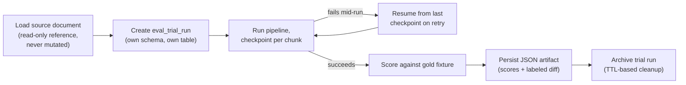

# `evals/` Framework — Design Doc

| | |
|---|---|
| **Author** | — |
| **Date** | 2026-10-26 |
| **Status** | Draft, for review |
| **Reviewers** | — |

## What it is

`evals/` is a formal evaluation framework for this project's AI-based document-processing pipelines. It measures, reproducibly and comparably over time, how accurately the pipelines perform against hand-verified ground truth.

It covers two pipelines:
- **Index/structure pipeline** — heading, section, and cross-reference extraction (does the AI find the right document structure, and does a citation like "see Annexure IV" resolve to the right target).
- **Action-items pipeline** — deadline/obligation/condition extraction from contracts and tenders.

## Why it exists

Accuracy questions ("did this prompt change help or hurt?") need an answer that's reusable and comparable over time, not a one-off script and a number that gets thrown away. `evals/` is a standing system: curated benchmark documents, pure scoring functions, a single pass/fail threshold, and a single CLI entry point, so a number produced today means the same thing as one produced next month.

## Architecture

```
evals/
  datasets/
    schema.py      # pydantic models for gold fixtures (GoldTarget, GoldMention,
                    # GoldIndexFixture, GoldActionItem, GoldActionItemsFixture)
    registry.py     # BenchmarkDataset dataclass + DATASET_REGISTRY:
                    # dataset_id -> {source_job_id, gold fixture paths, domain,
                    # page_count, default_trials}
    loader.py       # load_gold_index_fixture / load_gold_action_items_fixture
  metrics/
    structure.py    # target_identifier, score_target_slice, family_drift, scope_accuracy
    grounding.py    # score_action_items, quote normalization/matching
    classification.py  # precision/recall/f1
  settings.py       # INDEX_GATES, ACTION_ITEMS_GATES — flat
                    # threshold dicts, one universal bar per pipeline
  gates.py          # evaluate_index_gates / evaluate_action_items_gates —
                    # compares measured values against the relevant gate
                    # dict, returns pass/fail + violation list
  runners/
    base.py         # BaseEvalRunner ABC
    index_runner.py # IndexTrialConfig, run_index_trial/run_index_benchmark
    action_items_runner.py  # same pattern for action items
  reporters/
    console.py      # human-readable summary
    markdown.py
    json_artifact.py  # persisted run records (data/eval_reports/*.json)
  cli.py            # single entry point: python -m evals.cli run --pipeline
                    # {index,action-items} --dataset <id> [...]
```

## Execution model — isolated, checkpointed, namespaced eval-run storage

Each trial runs against its **own dedicated, namespaced storage** (`eval_trial_runs`/`eval_trial_pages` tables, mirroring only what scoring needs), not the production job table. This keeps test-harness concerns (trial lifecycle, retries, scoring state) separate from the real job state machine (status transitions, pause/resume, user-facing lifecycle) that production jobs use.



This gives the framework three properties as a single, coherent design, not three separate add-ons:
- **The real pipeline runs end-to-end**, not a mock or simulation — the source document is read-only input, never touched by the trial itself.
- **Resumability** — per-chunk checkpoints mean a retry (whether from an infrastructure hiccup or a transient provider failure) picks up from the last completed chunk instead of reprocessing the whole document.
- **An audit trail** — a trial run, including a failed one, survives (archived, expired on a TTL) rather than being torn down the moment something goes wrong — exactly when its data is most useful for debugging.

### Storage schema

```sql
CREATE TABLE eval_trial_runs (
    trial_run_id        TEXT PRIMARY KEY,   -- uuid
    dataset_id          TEXT NOT NULL,      -- e.g. "appeal-100p" (DATASET_REGISTRY key)
    pipeline             TEXT NOT NULL,      -- "index" | "action-items"
    provider             TEXT NOT NULL,      -- "ollama_native" | "gemini" | ...
    config_json          TEXT NOT NULL,      -- serialized trial config (chunk_pages, two_pass,
                                             -- adaptive_chunking, review_rule_prior, trial_idx, ...)
    scoring_version       TEXT NOT NULL,      -- see Versioning — fingerprints the scoring logic in use
    status                TEXT NOT NULL,      -- "running" | "done" | "failed" | "archived"
    last_checkpoint_chunk INTEGER,            -- index into the pipeline's own chunk plan; null until
                                             -- the first chunk completes
    error_message         TEXT,               -- populated only when status = "failed"
    created_at            TEXT NOT NULL,
    updated_at             TEXT NOT NULL,
    archived_at            TEXT               -- set when the TTL sweep archives a completed/failed run
);

CREATE TABLE eval_trial_pages (
    trial_run_id          TEXT NOT NULL REFERENCES eval_trial_runs(trial_run_id),
    page_num               INTEGER NOT NULL,
    source_text             TEXT NOT NULL,     -- copied read-only from the source document at trial start
    chunk_index              INTEGER,           -- which processing chunk this page belongs to
    extracted_targets_json   TEXT,              -- the pipeline's output for this page, once processed
    processed_at              TEXT,             -- null until this page's chunk completes
    PRIMARY KEY (trial_run_id, page_num)
);
```

A resume-on-retry reads `last_checkpoint_chunk` from `eval_trial_runs`, re-plans the same chunk boundaries deterministically from `config_json` (chunk planning is a pure function of config + page text, so this is reproducible without needing to persist the chunk plan itself), and continues from `last_checkpoint_chunk + 1` — every page with `processed_at IS NOT NULL` is already scored material and is never reprocessed.

## Key design decisions, and why

**Gold fixtures are built from real OCR'd text and grounding-validated.** Every fixture's `evidence_quote`/heading label is checked to literally exist in the real stored OCR text (via the same grounding functions the live pipeline uses, e.g. `locate_action_item_block`/`locate_heading_block`) before it's trusted. A fixture that doesn't ground against real text is worse than no fixture — it would silently and permanently miscalibrate every future measurement against it.

**Real documents, not synthetic test cases.** Real OCR'd documents carry real production artifacts — OCR noise, HTML-rendered tables, mixed-language (Hindi/English) content, inconsistent numbering schemes. A synthetic test document wouldn't exercise any of that. The whole value of this framework comes from testing against the actual mess production documents contain.

**One universal gate bar for the index pipeline: precision ≥0.85, recall ≥0.95.** Every benchmark document is held to the same standard regardless of domain (dense commercial tender, narrative legal judgment, bilingual bid document, ...).

**Merged / AI-only / Rule-only three-way scoring split.** The pipeline has both a deterministic rule engine and an AI layer. Scoring keeps them separate so a regression in the AI layer can't be laundered by the rule engine's contribution to the merged number. The rule-only path carries a strict **1.000 recall invariant** — since it's fully deterministic, it must never regress; any drop is a canary for something seriously wrong elsewhere in the pipeline.

**Scope accuracy and family drift are tracked separately from precision/recall.** A target can be correctly *found* (counting toward precision/recall) while still being nested under the wrong parent (`scope_key` mismatch) or classified under the wrong structural family (e.g. minted as `numheading:` when gold expects `subdoc:`). These are distinct failure modes precision/recall alone can't see, so they get their own metrics rather than being averaged away.

**Multiple trials and variance reporting, not single-run numbers.** The underlying AI providers exhibit real non-determinism — both the expected kind (sampling) and backend-level non-determinism from serving-stack batching/concurrency, present even at `temperature=0`. A single trial's score can mislead in either direction, so the framework runs multiple trials and reports the full min/mean/max spread, treating any single trial as one data point, not the answer.

**Provider-agnostic by design.** The same benchmark runs against any configured provider (self-hosted via Ollama, or cloud providers like Gemini) with identical scoring and gates — comparing providers, or substituting one for another when one is unavailable, is a configuration change, not a different code path.

**A single source of scoring logic, used everywhere.** `scripts/score_reference_index.py` and `scripts/score_action_items.py` are thin CLI wrappers over `evals.metrics`/`evals.runners` — the scoring logic itself lives in exactly one place, imported by every caller rather than duplicated.

**JSON artifact persistence with a labeled diff, not just an aggregate score.** Every run saves a timestamped artifact (`data/eval_reports/eval_<pipeline>_<dataset>_<timestamp>.json`) containing per-trial results *and* a labeled false-positive/false-negative diff (page, key, family, detection_source for each). Clustering false positives/negatives by page and family is the primary way a real accuracy regression gets root-caused — the aggregate precision/recall number alone is a symptom, not a diagnosis.

**Gold fixtures are validated for internal consistency, not just grounded against source text.** A fixture is linted for structural self-consistency (e.g. duplicate targets, conflicting scope paths) as part of how it's authored and maintained, since a fixture with an internal inconsistency miscalibrates every measurement taken against it just as badly as one that doesn't ground against the real document.

## Gold fixture lifecycle

Adding a new benchmark document:
1. **Select a representative real document** already processed by the production pipeline (or run it through once to get it OCR'd) — a document is chosen for what it exercises (dense tables, bilingual content, narrative legal structure, ...), not for convenience.
2. **Pull its real, stored OCR text directly** — never re-derive or paraphrase it. The fixture is authored by reading this text, not by reading the original PDF/rendering, since the pipeline only ever sees the stored OCR text.
3. **Hand-author the expected targets** (headings, cross-references, action items, or OCR ground truth, depending on pipeline) directly against that real text.
4. **Grounding-validate every entry** — every `evidence_quote`/label is checked to literally exist (exact or fuzzy-matched) in the real stored text it claims to come from, using the same grounding function the live pipeline itself uses. An entry that doesn't ground is corrected or removed before the fixture is trusted.
5. **Lint for internal self-consistency** — duplicate targets, conflicting scope paths, and similar structural issues are checked before the fixture is registered.
6. **Register it** in `DATASET_REGISTRY` (`evals/datasets/registry.py`) with its domain, page count, and default trial count.

Updating an existing fixture, when the pipeline's expected output changes on purpose (not a regression):
- The fixture change ships in the same review as the behavior change that motivates it, with the real-text justification stated explicitly (which lines of real text changed what's expected, and why) — a fixture change arriving disconnected from a described behavior change is treated as suspicious until explained, since that's exactly the shape a regression masked as a fixture fix would take.
- Steps 4-5 above (grounding + self-consistency validation) re-run on the changed fixture before it's trusted again.

## Versioning

Every saved JSON artifact (`data/eval_reports/eval_<pipeline>_<dataset>_<timestamp>.json`) carries a `scoring_version` fingerprint (see the storage schema above) identifying the scoring logic that produced it. Two artifacts are only ever compared directly, or plotted on the same trend line, when their `scoring_version` matches — a change to how precision/recall/scope-accuracy is computed bumps this fingerprint, so a past run never silently gets reinterpreted under new scoring rules. The gold fixture's own content is versioned by the same git history that versions the code — a fixture correction and the behavior change that motivated it land in the same commit/PR, so `git blame` on a fixture always points at the reason it changed.

## Operational model

Running `evals.cli run --pipeline <X> --dataset <Y>` produces a console summary, a JSON artifact, and a process exit code — `0` if every gate passed, non-zero with a listed violation set otherwise. That exit code is the integration point: whatever invokes the run (an engineer's terminal, a scheduled job, a CI step) decides what to do with it — block a merge, send a notification, or simply log it for the next person to look at. The framework itself doesn't presume which of these it's wired into; it guarantees that a gate failure is always unambiguous and always comes with the labeled diff needed to investigate it, regardless of what's consuming the exit code.

## Cost and performance envelope

A single two-pass index-pipeline trial on a 100-150 page document runs on the order of 80-115 AI calls (a handful for the coarse macro pass, the remainder for density-adaptive micro chunks). Per-call latency depends on the provider: a self-hosted Ollama model typically takes a few seconds to tens of seconds per call (occasionally 150-200s on a chunk that needs splitting and retrying), putting a full trial at roughly 10-30 minutes wall-clock; a cloud provider like Gemini typically completes the same trial in a few minutes. A benchmark run across both documents, multiple trials each (to get a real variance spread rather than a single number), is therefore a tens-of-minutes-to-low-single-digit-hours operation depending on provider and trial count — informing it as a scheduled/on-demand operation rather than something run on every commit.

## Extensibility — adding a new pipeline type

Each of the four existing pipelines follows the same shape, which is what makes adding a fifth one mechanical rather than a redesign. Using a hypothetical "table/figure extraction accuracy" pipeline as a worked example:
1. **`evals/datasets/schema.py`** — add a `GoldTableFixture` pydantic model (whatever ground truth that pipeline needs — e.g. expected table boundaries and cell contents per page).
2. **`evals/metrics/`** — add a module with pure scoring functions (precision/recall or whatever metric fits) that take gold + actual and return a score dict — no side effects, no I/O, matching every existing metrics module.
3. **`evals/runners/`** — add a `TableEvalRunner(BaseEvalRunner)` following `IndexEvalRunner`'s shape: create an `eval_trial_run`, invoke the real pipeline against the trial's namespaced pages, score via the new metrics module, persist the artifact.
4. **`evals/settings.py`** — add a `TABLE_GATES` flat threshold dict, same shape as `INDEX_GATES`/`ACTION_ITEMS_GATES`.
5. **`evals/gates.py`** — add `evaluate_table_gates`, same shape as the three existing `evaluate_*_gates` functions.
6. **`evals/cli.py`** — add `"table"` to the `--pipeline` choices and wire the new runner/gate function into the dispatch.

No change is needed to the storage schema, the checkpoint/resume mechanism, the reporters, or the CLI's overall structure — those are already generic across pipeline type.
