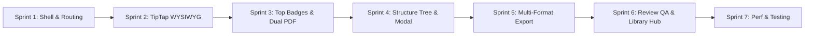

# OCR Studio Pro — UX Redesign & WYSIWYG Editor Implementation Plan

**Target Architecture:** Perspective 4 (Document Studio Pro)  
**Living Mockups Reference:** [`OCR Viewer — Perspective 4 Studio & WYSIWYG Editor Mockups.html`](file:///c:/Users/Tarundeep/Desktop/ocr-services/OCR%20Viewer%20%E2%80%94%20Perspective%204%20Studio%20&%20WYSIWYG%20Editor%20Mockups.html)  
**Document Version:** 1.1.0 (Validated Production Roadmap)  
**Target Codebase:** [`ocr-services`](file:///c:/Users/Tarundeep/Desktop/ocr-services) (`frontend/` + FastAPI backend)

---

## 1. Executive Summary & Vision

### The Problem
The current OCR Viewer was built primarily from an engineering perspective: displaying raw extracted OCR blocks, requiring users to read and edit raw Markdown syntax, hiding citations at the bottom of pages, and cluttering the workspace with redundant buttons and disconnected modals. Non-technical users (legal analysts, procurement teams, tender reviewers) struggle because:
1. They do not know Markdown formatting rules (tables, pipes, hashes for headings).
2. They cannot cross-verify cited clauses against referenced pages without losing their reading place.
3. Exporting is limited, requiring manual copy-pasting rather than clean Word `.docx` or publication-grade PDF deliverables.
4. Reviewing low-confidence OCR output requires hunting through all pages instead of following a focused QA queue.

### The Solution: Perspective 4 (Studio Pro)
Perspective 4 re-imagines the platform as a **full Document Studio** that pairs:
- A **Word-style WYSIWYG Rich Editor** that completely abstracts Markdown while auto-syncing clean Markdown to the database.
- A **Dual PDF Compare Mode (PDF Only)** that automatically tucks the editor away when inspecting cross-references, providing 50/50 full-width side-by-side reading clarity.
- **Top-Docked Cross-Reference Badges** surfaced prominently above the document scan for zero-scroll discovery.
- A **Collapsible Document Structure Tree (260px)** for outline navigation, clause reordering, and hierarchy management.
- A **One-Click Multi-Format Export Engine** for Markdown (`.md`), Microsoft Word (`.docx`), and publication-grade PDF with scope selection and clipboard copy.
- A **Guided Review Queue** with single-page GPU retry escalation that isolates flagged pages for rapid proofreading.
- A **Modern Library Hub** with hero drag-and-drop upload, quality presets, and status filtering.

---

## 2. Core UX & Architectural Foundations

```
┌────────────────────────────────────────────────────────────────────────┐
│                        TOP APP BAR (52px)                              │
│ [← Library]  [Title + Page Badge]   [Split | Dual PDF | Editor]  [Export ▾]│
├─────────┬───────────────────────────────┬──────────────────────────────┤
│ 48px    │ PANE 1: ORIGINAL PDF SCAN     │ PANE 2: WYSIWYG RICH EDITOR  │
│ ICON    │ ┌───────────────────────────┐ │ ┌──────────────────────────┐ │
│ RAIL    │ │ [🔗 Top Reference Badges] │ │ │ [B] [I] [U] [H2▾] [⊞] [≡]│ │
│         │ ├───────────────────────────┤ │ ├──────────────────────────┤ │
│ [▦] Pgs │ │                           │ │ │ 2. Rent & Security       │ │
│ [☰] Out │ │   Page Scan (300 DPI)     │ │ │                          │ │
│ [⚠️] Rev │ │   with Sync Bounding Box  │ │ │ Rich Editable Table:     │ │
│         │ │   (Hover Highlights Text) │ │ │ ┌────────┬─────────────┐ │ │
│         │ │                           │ │ │ │ Period │ Base Rent   │ │ │
│         │ └───────────────────────────┘ │ └─┴────────┴─────────────┴─┘ │
├─────────┴───────────────────────────────┴──────────────────────────────┤
│ FOOTER BAR (48px): [◀ Prev Page]       [Page 3 of 42]     [Next Page ▶]│
└────────────────────────────────────────────────────────────────────────┘
```

### 2.1 Two-Phase Document Lifecycle (Default OCR vs On-Demand Indexing)
1. **Phase 1: Default Landing (OCR Transcription & Proofreading)**:
   - When any user uploads a PDF, the default action is **OCR processing** (rasterizing pages and extracting text/tables).
   - The user immediately lands on a pristine **Split View (50/50)**: 300 DPI scan on the left, WYSIWYG editor on the right.
   - **Zero Indexing Overhead by Default**: The document outline and cross-reference citations are **not built by default** for all users. The initial canvas is 100% paper-clean, allowing users who only need transcription or proofreading to edit and export immediately.
2. **Phase 2: On-Demand Indexing & Citations (`[⚡ Build Index & Citations]`)**:
   - For users who want document structure, section hierarchies, and clause cross-references, an explicit action is provided: **`[⚡ Build Index & Citations]`** (located in the top bar and Outline drawer).
   - Triggering this runs the background indexing pass (`POST /api/jobs/{id}/reindex-references`), unlocking:
     - The **Document Structure Tree** (H1 > H2 > H3 outline).
     - Docked **Page Reference Badges** (`[§ 4.2 Security Deposit ➔ P.12]`, `[Clause 9.0 ▾]`).
     - Click-to-compare **Dual PDF Compare Mode**.

### 2.2 Three Dynamic Studio Modes
1. **Split View (Default)**: 45% PDF Scan + 55% WYSIWYG Editor.
2. **Dual PDF Compare (PDF Only)**: Activated automatically when clicking any citation badge (e.g., `[🔗 § 4.2 Security Deposit P.12]`). The editor is tucked away, placing Page 3 and Page 12 side-by-side at 50/50 full width.
3. **Editor Only**: Distraction-free full-width drafting mode for extensive editing.

### 2.3 Simplified Interaction Model (Zero Clutter)
- **Unified Return Path**: To exit Dual Compare mode, the user has one unambiguous button: **`[📝 Return to Editor]`** in the top app bar, or a standard **`[✕]`** close icon on the reference pane header.
- **Single Header Per Pane**: No stacked sub-headers. Citation badges are integrated directly into Pane 1's header; target anchors and jump buttons are integrated into Pane 2's header.
- **Clean Document Canvas**: No floating stickers pasted on top of document text. Sync bounding boxes are rendered as non-intrusive glowing overlays.

---

## 3. Detailed Feature Breakdown & Technical Strategy

### Feature 1: Word-Style WYSIWYG Rich Editor
- **End-User Value**: Users can format text with standard formatting buttons (`Bold`, `Italic`, `Underline`, `Align`, `Headings H1-H3`, `Lists`, `Tables`), without knowing Markdown.
- **Underlying Mechanism**:
  - Use **TipTap (ProseMirror)** as the editor engine:
    - Native React 18 integration.
    - Official extensions: `@tiptap/extension-table`, `@tiptap/extension-table-row`, `@tiptap/extension-table-header`, `@tiptap/extension-table-cell`, `@tiptap/extension-underline`, `@tiptap/extension-text-align`.
    - Bidirectional Markdown serializer (`tiptap-markdown`):
      - Ingestion: Clean Markdown from database $\rightarrow$ TipTap Document AST.
      - Persistence: TipTap Document AST $\rightarrow$ Clean GitHub-Flavored Markdown string stored in database.
  - **Raw Source Toggle**: A `</> Source` button in the toolbar allows technical power users to inspect/edit raw Markdown when desired.
  - **Debounced Autosave**: Changes autosave after 800ms idle with a visual status indicator (`● Saving...` $\rightarrow$ `✓ All Saved`).
  - **Bidirectional Bounding Box Mapping**:
    - The backend OCR engine outputs word- and block-level bounding boxes `[ymin, xmin, ymax, xmax]`.
    - Custom TipTap node attributes (`data-bbox`) are attached to table cells and block elements.
    - Focusing/hovering an element emits an `onNodeFocused(bbox)` event to `PdfCanvasViewer`, which renders a synced glowing rectangle (`.bounding-box-sync`) at the exact coordinate on the 300 DPI scan.

### Feature 2: On-Demand Cross-Reference Badges & Outline Tree
- **End-User Value**: Before indexing is built, the user works with a clean OCR canvas without waiting for background index passes. When the user clicks `[⚡ Build Index & Citations]`, prominently surfaced badges (`[📌 § 4.2 Security Deposit ➔ P.12]`) and the Outline drawer immediately tell the user which sections depend on clauses elsewhere.
- **Technical Mechanism**:
  - Initial state: `referenceStore = null`, `pageMentions = []`. Neither citation pills nor outline entries are rendered.
  - On user click of `[⚡ Build Index & Citations]`, the client calls `POST /api/jobs/{id}/reindex-references`.
  - Once indexed, `ai_reference_index.py` / `reference_index.py` populates `ocr_reference_targets` and returns cross-references per page:
    ```json
    {
      "page_num": 3,
      "references": [
        {
          "citation_text": "§ 4.2 Security Deposit",
          "target_page": 12,
          "target_section": "4.2",
          "target_anchor_text": "Amount and Replenishment",
          "confidence": 0.96
        }
      ]
    }
    ```
  - `PageReferenceBadges.jsx` docks these at the top of Pane 1:
    - Single unique match: Direct click $\rightarrow$ Opens Dual PDF Compare mode.
    - Multiple matches: Click $\rightarrow$ Opens Candidate Disambiguation Picker (`PageReferenceCandidatesModal.jsx`).

### Feature 3: Dual PDF Compare Mode (PDF Only)
- **End-User Value**: Compare clause text in context on both pages side-by-side with 100% width, eliminating cramped 3-pane splits.
- **Technical Mechanism**:
  - In `StudioView.jsx`:
    ```jsx
    const [viewMode, setViewMode] = useState('split'); // 'split' | 'dual_pdf' | 'editor_only'
    const [pinnedReference, setPinnedReference] = useState(null); // { targetPage: 12, section: '4.2' }
    ```
  - When `pinnedReference` is set:
    - `viewMode` automatically switches to `'dual_pdf'`.
    - Left pane renders `PdfCanvasViewer` for `currentPage` (Page 3).
    - Right pane renders a second instance of `PdfCanvasViewer` initialized to `targetPage` (Page 12), with free scroll allowed on neighboring pages (11–13).
    - The target anchor (`§ 4.2`) is highlighted with an amber callout bounding box.
    - A single `[📝 Return to Editor]` button resets `viewMode = 'split'` and clears `pinnedReference`.

### Feature 4: Collapsible Document Structure Tree (260px)
- **End-User Value**: A table of contents tree allowing instant page navigation, section folding, and structural reordering.
- **Technical Mechanism**:
  - Toggled via `☰` on the 48px left rail.
  - Backed by existing `structure_overrides.py` and `database.py` structure tree APIs.
  - Retains existing modal dialogs (`StructureItemModal.jsx` and `StructureDeleteConfirmModal.jsx`).
  - Features:
    - Section badge with target page number.
    - Inline edit title on double-click.
    - Drag-and-drop hierarchy reordering using `@dnd-kit/core` (already in `package.json`).
    - `+ Add Section` / `✕ Delete` actions with confirmation modal.

### Feature 5: Multi-Format Export Pipeline
- **End-User Value**: Users can export transcripts in GitHub Markdown, native Microsoft Word (`.docx`), or publication-grade PDF with scope selection and clipboard copy.
- **UI Specifications (Slide 08)**:
  - Format cards: `.md` (GFM), `.docx` (Recommended), `.pdf` (Print-ready).
  - Scope radio options: `Full Document (42 pages)` vs `Current Page Only (P.3)`.
  - Metadata toggle: `[x] Include review warnings & confidence metadata`.
  - Actions: `📋 Copy to Clipboard` (client-side HTML/text) + `Download (.docx) ➔`.
- **Windows-Compatible Library Stack**:
  - **Microsoft Word (`.docx`)**: `python-docx` (pure-Python wheel, zero native C-dependencies, native Word table styling).
  - **Publication PDF (`.pdf`)**: Use pure-Python **`reportlab`** / **`xhtml2pdf`**, or delegate to a headless browser service. **Avoid WeasyPrint** on Windows due to external GTK3/Pango/Cairo DLL dependencies.
- **API Endpoint Contract**:
  ```http
  GET /api/documents/{doc_id}/export?format={md|docx|pdf}&scope={full|page}&page_num={n}&include_metadata={bool}
  ```

### Feature 6: Guided Review Queue & In-Place Proofreading QA
- **End-User Value**: Reviewers review only the 3 flagged low-confidence pages instead of paging through 300 pages, with direct in-place rich text editing to immediately fix mistranscriptions.
- **Technical Mechanism (Slide 03)**:
  - 260px review drawer listing flagged pages with actual backend confidence metrics (e.g., `Page 14 · Needs Review · 71%`).
  - **In-Place WYSIWYG Rich Editor**:
    - TipTap editor enabled by default with an explicit `[✎ Edit Mode: ON]` toggle button and `● Autosaved` status.
    - Full formatting ribbon: Undo, Redo, Heading style dropdown, Bold/Italic/Underline, Lists, and Table controls.
    - **Suspect Token Visual Indicators**: Suspect low-confidence values (e.g., smudged decimals, numbers) are styled with warm warning highlights (`<mark>`) and tooltips (`Suspect OCR value · 71% · Click to edit directly`), enabling instant proofreading.
  - **Role-Gated Actions**:
    - General Users: Direct rich-text proofreading, editing, and `[✓ Mark Verified & Next]` advancement.
    - Admins: Optional single-page re-extraction via `[⚡ Rerun [Admin]]` calling `POST /api/documents/{doc_id}/pages/{page_num}/retry`.
  - Stepper action: `[✓ Mark Verified & Next]` advances through the queue until all flagged pages are verified.

### Feature 7: Modern Library Home Hub
- **End-User Value**: A clean document repository home (`/`) replacing the monolithic `Dashboard.jsx`.
- **UI Specifications (Slide 01)**:
  - **Hero Drag-and-Drop Upload**: Drop PDF/images with visual progress.
  - **Quality Presets**: `Standard Mode (Recommended)` vs `High Precision + Grounding`.
  - **Advanced Parameters Drawer**: Model engine, prompt overrides, tiling config.
  - **Search & Status Filters**: Search by document title; filter pills: `All`, `Completed`, `Needs Review`, `Processing`.
  - **Document Table**: Name, page count, status pill, confidence tag, created date, and direct action buttons (`Open Studio ➔`, `⚠️ Review Queue (2)`, `Export ▾`).

---

## 4. Frontend Component Hierarchy & State Architecture

```
frontend/src/
├── App.jsx                       # React Router: / (Library) vs /studio/:docId
├── index.css                     # Design tokens (colors, dark theme, elevation)
├── pages/
│   ├── LibraryHome.jsx           # Slide 01: Modern Library Hub (decoupled from Dashboard)
│   └── StudioView.jsx            # Studio container managing layout & viewMode
├── components/
│   ├── studio/
│   │   ├── StudioAppBar.jsx      # Slide 02: Top bar, quiet file meta, primary Export action
│   │   ├── StudioRail.jsx        # 44px left action rail (Pages, Outline, Review Flags)
│   │   ├── StudioFloatingHud.jsx # Frosted glass floating navigation & view HUD
│   │   ├── StructureTreePanel.jsx# Slide 07: 280px collapsible outline sidebar
│   │   ├── PageReferenceBadges.jsx # Slide 04: Top-docked citation badges
│   │   └── ExportDropdown.jsx    # Slide 08: Consolidated format download modal
│   ├── editor/
│   │   ├── WysiwygEditor.jsx     # Slide 02: TipTap rich editor core
│   │   ├── EditorToolbar.jsx     # Word-style formatting toolbar
│   │   ├── TableControls.jsx     # Add/remove row, col, delete table
│   │   └── MarkdownBridge.js     # Two-way sync: TipTap AST ↔ Markdown string
│   ├── viewer/
│   │   ├── PdfCanvasViewer.jsx   # PDF.js render canvas with zoom & pan
│   │   ├── DualPdfCompare.jsx    # Slide 06: 50/50 Dual PDF comparison pane
│   │   ├── BoundingBoxSync.jsx   # Synchronized scan-to-editor highlight overlay
│   │   └── ReferenceModal.jsx    # Slide 05: Prompted citation disambiguation popover
│   └── review/
│       ├── ReviewQueuePanel.jsx  # Slide 03: Low-confidence page filter list
│       └── UncertainCellMarker.jsx# Amber badge overlay & pixel crop inspector for suspect tokens
```

---

## 5. Optimized Implementation Roadmap (Sprint Sequencing)



### Sprint 1: Studio Container Shell & Routing Decoupling
- [ ] Split monolithic `Dashboard.jsx` into `pages/LibraryHome.jsx` and `pages/StudioView.jsx`.
- [ ] Configure clean routes in `App.jsx`:
  - `/` $\rightarrow$ `LibraryHome.jsx`
  - `/studio/:docId` $\rightarrow$ `StudioView.jsx`
  - `/studio/:docId/review` $\rightarrow$ `StudioView.jsx` (initial `viewMode = 'review'`)
- [ ] Build the core studio scaffolding: `StudioAppBar.jsx`, 48px `StudioRail.jsx`, and `StudioFooter.jsx`.

### Sprint 2: WYSIWYG Editor Core & Markdown Bridge
- [ ] Install TipTap dependencies (`@tiptap/react`, `@tiptap/pm`, `@tiptap/starter-kit`, table extensions, text-align, underline, `tiptap-markdown`).
- [ ] Implement `WysiwygEditor.jsx` with Word-style `EditorToolbar.jsx` and `TableControls.jsx`.
- [ ] Implement `MarkdownBridge.js` with bidirectional serializer (GFM tables, bold/italic, lists).
- [ ] Implement `</> Source` raw Markdown view toggle and debounced autosave.
- [ ] Wire block/cell `data-bbox` attributes for scan highlight coordination.

### Sprint 3: Top Badges & Dual PDF Compare (PDF Only)
- [ ] Refactor `PageReferenceBadges.jsx` to dock at the top of Pane 1 with glowing pill buttons.
- [ ] Build `DualPdfCompare.jsx` mounting two `PdfCanvasViewer` components at 50/50 width.
- [ ] Implement target clause bounding box highlighting (`🎯 TARGET CLAUSE (§ 4.2)`).
- [ ] Implement unified return path: `[📝 Return to Editor]` in app bar and `[✕]` on target header.

### Sprint 4: Structure Tree Drawer & Tabbed Inspection Modal
- [ ] Transform `StructureTree.jsx` into the collapsible 260px drawer (`StructureTreePanel.jsx`).
- [ ] Wire `@dnd-kit/core` drag-and-drop hierarchy reordering.
- [ ] Modernize `StructureReadingModal.jsx` into the tabbed quick-peek inspection modal (PDF Scan vs Clean Text).

### Sprint 5: Multi-Format Export Pipeline (Word .docx + Windows PDF)
- [ ] Add `python-docx` and pure-Python PDF generator (`xhtml2pdf` or `reportlab`) to `requirements.txt`.
- [ ] Implement backend `export_service.py` supporting `format`, `scope`, `page_num`, and `include_metadata`.
- [ ] Expose `GET /api/documents/{doc_id}/export` in `main.py`.
- [ ] Build `ExportDropdown.jsx` with format cards, scope radio selector, metadata checkbox, and clipboard copy.

### Sprint 6: Guided Review Queue & Modern Library Hub
- [ ] Build `ReviewQueuePanel.jsx` filtering pages by confidence $< 80\%$.
- [ ] Implement `[↺ Retry with GPU Escalation]` calling `POST /api/documents/{doc_id}/pages/{page_num}/retry`.
- [ ] Implement `[✓ Accept & Next Flagged]` sequential verification stepper.
- [ ] Complete `LibraryHome.jsx` with Hero Upload, quality presets, search, and status filter tabs.

### Sprint 7: Performance Optimization, Accessibility & End-to-End Testing
- [ ] Code-split and lazy load PDF.js and TipTap editor bundles.
- [ ] Keyboard shortcuts: `Ctrl+B`, `Ctrl+I`, `Ctrl+U`, `Ctrl+Z`, `Ctrl+Y`, `Escape` (exit Dual PDF).
- [ ] Automated round-trip tests for Markdown serializer fidelity and export file generation.

---

## 6. Success Metrics & Acceptance Criteria

1. **Zero Markdown Friction**: Non-technical users perform 100% of formatting tasks via familiar Word-style controls without typing Markdown tokens.
2. **Instant Citation Verification**: Clicking any citation opens the side-by-side comparison in $< 300\text{ms}$ with zero 3-pane cramping.
3. **Uncluttered Interface**: Single primary return action, zero stacked duplicate headers, and clear visual hierarchy.
4. **Export Completeness**: One-click download of `.md`, `.docx`, and `.pdf` with exact table structures, headings, and optional metadata.
5. **Windows Build Stability**: Zero external GTK/Pango C-library dependencies for document exports.
6. **QA Velocity**: Low-confidence page proofreading time reduced by $> 60\%$ via the focused Review Queue and GPU retry button.

---

## 7. Future Architectural Enhancement: Continuous Page Scroll & Dual-Pane Synchronization ("Scroll Spy")

### 7.1 Problem Analysis: Why Inter-Page Scrolling Was Disabled
In the current implementation, natural continuous vertical scrolling between pages was disabled in favor of discrete `[◀ Prev]` / `[Next ▶]` button pagination. This restriction was introduced to address two severe UX/technical failure modes:
1. **Vertical Ratio Drift (Naive Percentage Syncing)**: 
   - A single PDF page has a rigid aspect ratio (typically A4 / 842pt), rendering at a fixed pixel height (e.g., $1100\text{px}$).
   - In contrast, the OCR extraction in the editor pane contains variable formatting: a sparsely populated cover page might render in only $150\text{px}$ of Markdown, while a complex 40-row tender table or fine-print legal annex might expand to $3200\text{px}$.
   - Linear percentage synchronization (`leftScrollTop / leftScrollHeight === rightScrollTop / rightScrollHeight`) inevitably causes the two panes to drift drastically out of alignment by Page 3 or 4.
2. **Canvas Memory Exhaustion**:
   - Mounting continuous `<canvas>` elements for 30–300+ scanned pages simultaneously triggers GPU memory exhaustion and crashes the browser tab.
3. **Bidirectional Event Feedback Loops ("Scroll Flutter")**:
   - When user scroll on Pane A programmatically adjusts the scroll position of Pane B, Pane B's native `onScroll` event fires and attempts to re-adjust Pane A, creating jitter, scroll lag, and trapping the user's cursor.

---

### 7.2 Library Strategy: Retaining `pdfjs-dist` vs. Alternative Libraries
- **Strategic Recommendation**: **Do NOT replace `pdfjs-dist` with a third-party wrapper library.**
- **Rationale**: 
  - `PdfCanvasViewer.jsx` already incorporates critical enterprise decoders: specifically, the bundled WASM configuration (`wasmUrl: '/pdfjs/wasm/'`) which ports Google Chrome's PDFium JBIG2/JPX decoders to prevent scanned government tender artifacts and black-box image rendering crashes.
  - Third-party React PDF wrappers (`@react-pdf-viewer`, `react-pdf`) abstract away canvas lifecycle control and often break or conflict with local WASM decoders and custom bounding-box highlight layers (`DualPdfCompare`).
- **Solution**: Retain native `pdfjs-dist` and introduce **DOM Page-Anchor Virtualization + Discretized IntersectionObserver ("Scroll Spy")**.

---

### 7.3 Core Technical Architecture: Page-Anchor "Scroll Spy"

```
┌──────────────────────────────────────────┐   ┌──────────────────────────────────────────┐
│             Pane 1: PDF Viewer           │   │         Pane 2: WYSIWYG Editor           │
├──────────────────────────────────────────┤   ├──────────────────────────────────────────┤
│ [Page 1 Container - min-h: 1100px]       │   │ [Page 1 Section - data-page="1"]         │
│   ├─ <canvas> (rendered)                 │   │   ├─ Header, Title, Intro                │
│                                          │   │                                          │
│ ═══════════ Human Reading Line (Top 35%) ════════════ Human Reading Line (Top 35%) ═════│
│                                          │   │                                          │
│ [Page 2 Container - min-h: 1100px]       │   │ [Page 2 Section - data-page="2"]         │
│   ├─ <canvas> (rendered via lazy buffer) │   │   ├─ 45-row Table (2400px height)        │
│                                          │   │                                          │
│ [Page 3 Container - min-h: 1100px]       │   │ [Page 3 Section - data-page="3"]         │
│   └─ Skeleton/Placeholder (unrendered)   │   │   └─ Paragraph text                      │
└──────────────────────────────────────────┘   └──────────────────────────────────────────┘
```

#### Key Architecture Principles:
1. **Discretized Page Anchors**:
   - The PDF container renders continuous page shells: `<div id="pdf-page-{n}" data-page="{n}" style={{ minHeight: pageHeight }}>`.
   - The WYSIWYG Editor/Markdown view renders corresponding semantic page wrappers: `<section id="editor-page-{n}" data-page="{n}">`.
   - Virtualization only mounts active `<canvas>` nodes within a $\pm 1$ page window of the viewport. Pages outside the viewport retain explicit placeholder heights so the scrollbar track remains physically stable.
2. **Top-Reading-Line IntersectionObserver**:
   - An `IntersectionObserver` configured with `rootMargin: "-15% 0px -65% 0px"` targets the top 35% of the viewport (the natural human reading line) to update page tracking.

---

### Section 8: Streamlined UX Redesign & Interaction Models (Post-Review Updates)

Based on industry UX research into Adobe Acrobat Pro, MS Word, Notion, and ABBYY FineReader, the interface has been overhauled to eliminate visual clutter and establish clear user workflow orientation.

#### 8.1 Resolution of Review Issues:
1. **Clear User Workflow Orientation (Addressing "Lack of Flow")**:
   - Replaced immediate dense tool presentation with a standard 3-phase journey:
     - **Phase 1: Ingestion & Verify**: Clean universal starting hub (`+ Upload PDF`, `Drop your PDF here`) with zero engine confusion.
     - **Phase 2: Pristine Workspace**: Immediate side-by-side view (300 DPI PDF scan vs TipTap rich text) with on-demand citation building (`[⚡ Build Index & Citations]`) and zero distraction badges.
     - **Phase 3: Export & Close**: Unambiguous, primary high-contrast action `[Export Document ▾]` at top right.
2. **De-Noising & Elimination of Chrome Stacking**:
   - Eliminated the persistent 48px footer bar (`.footer-nav`) and removed noisy telemetry badges from default landing.
   - Reclaimed +50px of vertical viewing space for document inspection.
3. **Strict Button & Control Clustering (Zero "AI Assist" Clutter)**:
   - **Family 1 (Global Document Header)**: `[← Library]`, document title, save status, `[🔍 Find Ctrl+F]`, `[⚡ Build Index & Citations]`, and primary `[Export Document ▾]`. (No generic or confusing `AI Assist` copilot buttons).
   - **Family 2 (Floating Navigation & View HUD)**: Adobe Acrobat-style frosted pill floating at bottom center combining Editable Page Jump (`[◀ Page [3] of 42 ▶]`), Zoom (`[− 100% + Fit]`), and View Modes (`[◫ Split | 📄 Scan | 📝 Text]`).
   - **Family 3 (Document Structure Drawer)**: Toggled via `[☰ Outline]` button, offering manual outline navigation and heading reordering.
   - **Family 4 (Docked Page References Bar)**: Positioned directly above the scan pane once indexing is built, displaying detected outgoing citations (`[§ 4.2 Security Deposit ➔ P.12]`, `[Clause 9.0 ▾ (2 targets)]`).
4. **End-User vs Admin Role Separation (Zero Engine Knobs for Users)**:
   - Regular users are **never forced to choose engines, models, prompts, chunk sizes, or indexing algorithms**.
   - In the Review Queue, general users have **full in-place TipTap rich editing tools** (`[✎ Edit Mode: ON]` toggle, formatting ribbon, suspect token highlights) to immediately fix mistranscribed text before clicking `[✓ Mark Verified & Next]`.
   - The **`[⚡ Rerun [Admin]]`** action is role-gated strictly for Admins to prevent unintended server GPU overhead.
   - All technical controls (Unlimited-OCR GPU vs GLM-OCR, layout grounding tags, AI structure indexing chunk parameters) are configured exclusively by administrators in **Admin Settings**.
   - End-user files automatically process using the organization's default pipeline.

#### 8.2 Enhanced Workflow Controls & Resolution of Secondary Gaps:
1. **Interactive Draggable Split Resizer**:
   - Central grab handle `⋮` between scan and editor with smooth mouse-tracking and hover presets `[30/70 | 50/50 | 70/30]`; double-click resets to 50/50.
2. **Dual-Pane Synchronized In-Doc Search (`Ctrl+F`)**:
   - Header button + floating search bar highlights matches simultaneously across both the PDF scan canvas (bounding-box overlays) and TipTap text (`<mark>`).
3. **Floating HUD Occlusion Protection, Editable Jump-to-Page & Docking Control**:
   - **Direct Page Jump**: The page number is an interactive input box (`Page [ 3 ] of 42`); typing any page number and hitting `Enter` jumps instantly to that page, with `▲`/`▼` arrow keys incrementing/decrementing.
   - Added `padding-bottom: 88px` buffer in document viewports and an interactive `[▾ Dock]` toggle to collapse the HUD into an ultra-compact pill.
4. **Streamlined 2-Button Left Rail with Labels & Rich Tooltips**:
   - Pruned redundant dummy thumbnail button (`📑`); the 52px rail features 2 clear labeled actions: **`[ ☰ Outline ]`** (Table of contents / structure tree, `Ctrl+1`) and **`[ ⚠️ Review (3) ]`** (Quality review queue, `Ctrl+2`).
   - Includes micro-labels underneath icons and rich hover tooltips with keyboard shortcuts for zero-guessing navigation.
5. **Multi-Target Candidate Disambiguation Picker**:
   - When a citation exists in multiple sections (e.g. `Clause 9.0` in SCC vs ITB), clicking its badge opens a clean candidate picker ranking exact subdocument scope matches (P.14) over cross-document fallbacks (P.32) before navigating.
6. **Page-Level Confidence Architecture & Proofreading Focus**:
   - Pruned noisy word-level dashed underlines and pixel-crop popovers to match backend reality (confidence tracked per page).
   - Document text remains 100% paper-clean. Low-confidence pages ($<80\%$) are isolated in the Review Queue for direct editor proofreading, with optional Admin Rerun controls.
7. **Dual PDF Compare Multi-Target Switcher**:
   - Target pane header provides citation tabs: `[Target 1: Cl. 4.2 (P.19)]`, `[Target 2: Annexure A-1 (P.27)]`, `[Target 3: Appx B (P.38)]` plus `[🔗 Sync Zoom: ON]`.
8. **Multi-Format Export Modal with Page Scope Range**:
   - Added radio options for `Entire Document`, `Current Section`, or `Custom Range (e.g. 1-5, 12, 19-24)` with figure/hyperlink formatting toggles.

#### 8.3 Chronological User Journey Architecture (Mockup Slides 01 to 08)

The living prototype and design walkthrough are organized chronologically to match the exact lifecycle of a user session:

| Slide | Screen Name | User Intent & Key Actions | Transition Trigger |
| :---: | :--- | :--- | :--- |
| **01** | **Modern Library Home Hub** | Clean dropzone (`+ Upload PDF`, `Drop your PDF here`) and recent documents list. Admin Settings link for defaults. | User clicks `[Open in Studio ➔]` $\rightarrow$ Slide 02 |
| **02** | **Clean Document Studio** | Pristine 50/50 split landing view with TipTap editor, docked citation strip, 2-button labeled rail & frosted HUD. | User clicks `⚠️ 3 Review` $\rightarrow$ Slide 03 |
| **03** | **Guided Review Queue** | Review section opens seamlessly on the left within Document Studio. Direct TipTap editing on Page 14. Role-gated `[⚡ Rerun]` for Admins. | User clicks `[✓ Mark Verified & Next]` $\rightarrow$ Slide 04 |
| **04** | **Citations & References** | In-context reading: docked citation pills (`§ 4.2 ➔ P.12`), clause hyperlinks, and scan bounding box sync. | User clicks `[§ 4.2 Security Deposit]` $\rightarrow$ Slide 06 |
| **05** | **Multi-Target Disambiguation** | Ranked picker resolves ambiguous mentions (Exact P.14 SCC vs Cross-Doc P.32 ITB). | User clicks candidate $\rightarrow$ Slide 06 |
| **06** | **Dual PDF Compare Mode** | 50/50 side-by-side clause verification with multi-target tabs & sync zoom. | User clicks `[Return to Studio]` $\rightarrow$ Slide 02 |
| **07** | **Document Structure Drawer** | 280px drawer for H1/H2/H3 outline navigation and drag-and-drop reordering. | User clicks `[Export Document ▾]` $\rightarrow$ Slide 08 |
| **08** | **Multi-Format Export Modal** | Choose Word `.docx`, PDF, or Markdown with custom page range & clean options. | User downloads deliverable or returns to Studio |


*All streamlined screens, interaction states, and the interactive theme switcher are documented in:*  
**[OCR Studio — Streamlined UX Redesign Mockups.html](file:///c:/Users/Tarundeep/Desktop/ocr-services/OCR%20Studio%20%E2%80%94%20Streamlined%20UX%20Redesign%20Mockups.html)**


